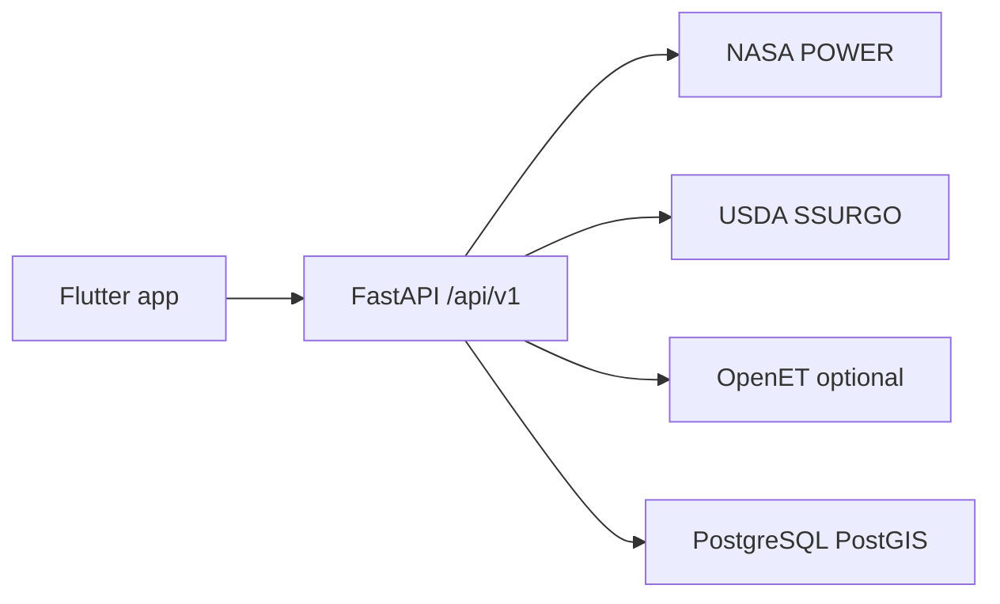

# NextHarvest

**NASA Space Apps Challenge 2026** — [*Field Shift: Adapting Farms with NASA Data*](https://www.spaceappschallenge.org/2026/challenges/adapting-farms-with-nasa-data/)

NextHarvest is a decision-support tool that helps farmers compare **crop rotation strategies** using **NASA climate data** and **USDA soil and market data**, grounded in the real-world alfalfa story from Churchill County, Nevada (Denise Moyle).

Stack: **Flutter** mobile client, **FastAPI** backend, **PostgreSQL + PostGIS**, harmonized field diagnostics, three explainable rotation scenarios, and climate scenario sliders. **API-facing text** (`message`, `health` labels, rotation explanations, glossary) is **English** for judges and Swagger demos.

---

## Project link (public)

**Repository:** https://github.com/maoubuda/nextharvest

No login is required to **view** this repository. To **run** the product locally, use [Quick start](#quick-start) below (backend + optional mobile app).

Add your **Space Apps project demo** here when ready (public link, no login—max **7 slides** or **30s** video per challenge rules). You can also add a hosted API URL if you deploy the backend.

---

## Problem and solution

**Problem.** Rain and temperature are harder to predict. Water is scarce and soils degrade. Farmers need **side-by-side rotation options** with traceable evidence—not an opaque AI prescription.

**Solution.**

1. Register and draw a field polygon on the map (or use the API with GeoJSON).
2. **Analyze** fuses NASA POWER (climate), USDA SSURGO (soil), and optional OpenET (evapotranspiration) into one harmonized summary with **health badges**.
3. **Recommend** returns **three strategies** (current baseline, water resilience, soil/market), each with **five required explanation sections** (why, evidence, benefits, gaps, risks).
4. **Simulate** adjusts annual rain (±30%) and temperature (+0–4 °C) and recalculates scores—no new NASA calls.

**Governance.** Recommendations **support, not replace**, local agronomist judgment. The API exposes data-source flags (`analysis_meta`, `nass_used`) and a static glossary that separates satellite estimates from in-field measurement. Strategy explanations use English templates (optional OpenAI rewrite when `OPENAI_API_KEY` is set).

---

## How this maps to the challenge

| Challenge requirement | Status | Where to see it |
| --------------------- | ------ | ---------------- |
| Compare ≥3 rotation strategies (incl. baseline) | Yes | `POST /api/v1/rotations/recommend` |
| Five sections per strategy | Yes | `RotationExplanation` in API; templates or OpenAI if `OPENAI_API_KEY` |
| Farmer priorities and constraints | Yes | `priorities` in recommend/simulate; mobile **recommendation form** (sliders) |
| Bare fields / vulnerability windows | Partial | `bare_field_months` from **NASA POWER** proxy (low ET + GWETROOT)—not Sentinel-2 yet |
| Data fusion on a common analysis unit | MVP | Climate at centroid + SSURGO on polygon + optional OpenET; no 30 m H3 grid yet |
| Scenario sliders (rain / temperature) | Yes | `POST /api/v1/rotations/simulate`; **recommendation results** screen in the app |
| Explain science; satellite vs in-situ | Partial | `GET /api/v1/glossary/explain`; diagnostics UI; recommendation cards (5 sections) |

We do **not** claim operational **SMAP L4**, **Sentinel-2** bare soil, or **AMS** prices in the live analyze path—those are documented roadmap items (CDSE connector is still a stub).

---

## Architecture at a glance



Full system design (Portuguese): [arquitetura_sistema_nextharvest.md](arquitetura_sistema_nextharvest.md).

---

## NASA and USDA data in the live API

| Source | Role |
| ------ | ---- |
| [NASA POWER](https://power.larc.nasa.gov/) | Precipitation, reference ET (`EVPTRNS`), root-zone wetness proxy (`GWETROOT`) |
| [OpenET](https://openetdata.org/) | Field-scale ET when `OPENET_API_KEY` is set |
| USDA [Soil Data Access](https://sdmdataaccess.sc.egov.usda.gov/) / SSURGO | Soil profile for the field polygon |
| USDA NASS QuickStats | County yield context when `NASS_API_KEY` is set (recommend) |
| FCC Census API | State and county from field centroid (no API key) |

**Roadmap:** SMAP / AppEEARS, Sentinel-2 via Copernicus CDSE, AMS market prices.

---

## Repository layout

| Path | Description |
| ---- | ----------- |
| [backend/](backend/) | FastAPI service, harmonizer, rotation engine, auth, tests (`pytest`) |
| [next_harvest_frontend/](next_harvest_frontend/) | Flutter app: auth, **My Fields**, map/analyze, diagnostics, **recommendations**, scenario sliders, settings/about |
| [backend/API_ROTAS.md](backend/API_ROTAS.md) | Route-by-route API guide (**English**) |
| [arquitetura_sistema_nextharvest.md](arquitetura_sistema_nextharvest.md) | Challenge traceability and architecture (Portuguese) |
| [relatorio_recursos_spaceapps_2026.md](relatorio_recursos_spaceapps_2026.md) | NASA Resources tab research (Portuguese) |

### End-to-end flows

- **API / Swagger:** register → analyze → recommend → simulate → `GET .../simulations/latest` (canonical for CI and judges without the mobile app).
- **Flutter app:** register → draw and submit a field on the map → **My Fields** → **field diagnostic** → **Recommend rotations** (farmer priority sliders) → **three strategies** with five explanation sections → adjust **rain/temperature** on the results screen (`POST /rotations/simulate`); **delete field** from the home list.

Map imagery and tile details: [next_harvest_frontend/README.md](next_harvest_frontend/README.md) (Portuguese). Core home, diagnostics, and recommendation screens use **English** UI copy; some map-drawing strings may remain bilingual.

---

## Quick start

### Backend (required for API demo)

From `backend/`:

```bash
docker compose up -d
cp .env.example .env
python3 -m venv .venv
source .venv/bin/activate   # Windows: .venv\Scripts\activate
pip install -e ".[dev]"
uvicorn app.main:app --reload
```

- API docs: http://127.0.0.1:8000/docs  
- Health: http://127.0.0.1:8000/health  
- Tests: `pytest` (mocked suite; optional `NEXTHARVEST_LIVE=1 pytest -m live` for real NASA/USDA/OpenET)

Optional keys in `backend/.env`: `OPENET_API_KEY`, `NASS_API_KEY`, `OPENAI_API_KEY`. Never commit real secrets.

**Swagger flow:** `POST /api/v1/auth/register` → **Authorize** with the JWT → `POST /api/v1/fields/analyze` → copy `field_id` → recommend → simulate.

Details: [backend/README.md](backend/README.md).

### Mobile app (optional)

From `next_harvest_frontend/`:

```bash
cp .env.example .env
```

Set `API_BASE_URL` (e.g. `http://127.0.0.1:8000` on desktop; `http://10.0.2.2:8000` for Android emulator → host machine).

```bash
flutter pub get
flutter run
```

Details: [next_harvest_frontend/README.md](next_harvest_frontend/README.md).

### Demo field (Churchill County, NV)

Use this body for `POST /api/v1/fields/analyze`:

```json
{
  "name": "Alfalfa Nevada",
  "current_crop": "Alfafa",
  "geometry": {
    "type": "Polygon",
    "coordinates": [[
      [-118.78, 39.47],
      [-118.77, 39.47],
      [-118.77, 39.48],
      [-118.78, 39.48],
      [-118.78, 39.47]
    ]]
  }
}
```

---

## API highlights

| Endpoint | Purpose |
| -------- | ------- |
| `GET /api/v1/fields/` | List owned fields (powers **My Fields** on mobile) |
| `POST /api/v1/fields/analyze` | Harmonized summary, `health`, `analysis_meta` |
| `GET /api/v1/diagnostics/{field_id}` | Persisted diagnosis (same badges) |
| `POST /api/v1/rotations/recommend` | Three strategies, `nass_used`, explanations |
| `POST /api/v1/rotations/simulate` | Climate sliders; persists history |
| `GET /api/v1/fields/{field_id}/simulations/latest` | Last simulation for the field |
| `DELETE /api/v1/fields/{field_id}` | Delete owned field and simulation history (204) |

Route reference: [backend/API_ROTAS.md](backend/API_ROTAS.md). Responses use **English** user-facing strings unless you customize the client.

---

## Team

**Team Averiguando Possível Resenha** — NASA Space Apps Challenge 2026.

---

## License and acknowledgments

**License:** TBD (to be added before final submission).

**Acknowledgments.** NASA Earth Science (POWER), USDA (SSURGO, NASS), OpenET consortium, and the NASA International Space Apps Challenge organizers.

---

## Tech stack

Python 3.12+, FastAPI, PostgreSQL/PostGIS, Flutter, Riverpod, Dio — automated tests in `backend/tests/`.

---

## Before you submit (maintainers)

- [ ] Confirm repository visibility is **Public**
- [ ] Replace or verify the GitHub URL above matches your canonical remote
- [ ] Add the **project demo** link under [Project link](#project-link-public) (≤7 slides or ≤30s video)
- [ ] Ensure `.env` files are gitignored; only `.env.example` is tracked
- [ ] Run `pytest` in `backend/` and fix any failures
- [ ] Re-read the [challenge mapping](#how-this-maps-to-the-challenge) table for overclaims (Sentinel, satellite SMAP)
- [ ] README mobile flow matches your submission **screenshots/GIF**
- [ ] After re-**analyze**, confirm `/docs` responses show **English** `message` and `health` labels

*Last updated: November 2026.*