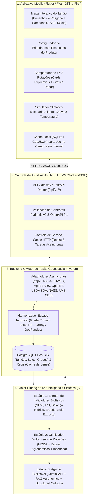

# Análise do Desafio e Arquitetura de Sistema — **NextHarvest**
**Desafio NASA Space Apps 2026:** [*Field Shift: Adapting Farms with NASA Data*](https://www.spaceappschallenge.org/2026/challenges/adapting-farms-with-nasa-data/)

---

## 1. Análise da Página do Desafio: Requisitos Funcionais e Técnicos

A partir da extração completa da aba *Details* da página oficial via **Scrapling**, o desafio propõe resolver um problema real inspirado na agricultura familiar multigeracional (ilustrado na página pelos campos de alfafa de Denise Moyle, em Nevada): **como escolher rotações de culturas resilientes diante de mudanças de temperatura, chuvas imprevisíveis, escassez hídrica e degradação do solo**.

### 1.1. Mapeamento dos Requisitos Obrigatórios e Desejáveis da Página

| Requisito da Página Oficial (*Objectives & Potential Considerations*) | Tradução em Funcionalidade de Sistema (`NextHarvest`) |
| :--- | :--- |
| **Comparar pelo menos 3 estratégias de rotação** (incluindo a rotação existente). | Motor de comparação lado a lado: **1) Rotação Atual (Baseline)**, **2) Rotação Resiliência Hídrica/Climática**, **3) Rotação Saúde do Solo & Renda/Mercado**. |
| **5 elementos obrigatórios por estratégia:** *(1) Por que foi sugerida, (2) Evidências que a suportam, (3) Benefícios, (4) Lacunas de informação (gaps) e (5) Riscos que exigem revisão local*. | Schema estruturado obrigatório na API e no Agente de IA (`RotationExplanationSchema`), exibido em cartões auditáveis no app mobile. |
| **Detectar períodos de solo exposto (*bare fields*) e estações de maior vulnerabilidade.** | Pipeline de série temporal óptica/termal (Sentinel-2 `SCL=5`, Landsat/MODIS `NDVI < 0.22`, ECOSTRESS/OpenET `ESI`) que marca no calendário anual da fazenda as janelas críticas de erosão e estresse térmico. |
| **Harmonização de dados (*Data Fusion*) em uma grade comum de análise.** | Motor geoespacial no backend que reamostra/interpola rasters multirresolução (10 m a 50 km) e vetores de solo (SSURGO) para uma **grade comum por talhão (30 m UTM / Hexágonos H3)**. |
| **Entrada de prioridades e restrições do produtor rural.** | Formulário interativo no app onde o produtor define pesos (Economia de Água, Fixação de Nitrogênio, Forragem, Controle de Erosão, Renda Extra, Maquinário/Irrigação disponível). |
| **Visualização geoespacial e *Scenario Sliders*.** | Mapa interativo de vulnerabilidade do talhão + controles deslizantes (*sliders*) para simular variações de chuva ($\pm 30\%$) e temperatura ($+1^\circ\text{C}$ a $+4^\circ\text{C}$). |
| **Explicar termos científicos e diferenciar satélite vs. dados *in-situ*.** | Camada de UX educativa (*Tooltips* + Assistente IA) explicando Evapotranspiração, NDVI, Anomalia de Umidade do Solo e apontando onde sensores locais/análise de solo de laboratório são necessários. |
| **Apoiar, e nunca substituir, o julgamento do produtor e agrônomos locais.** | Alertas de governança de IA, barra explícita de **Grau de Confiança / Incerteza dos Dados** e checklist de validação agronômica local antes do plantio. |

---

## 2. Visão Geral da Arquitetura do Sistema (End-to-End)

Abaixo está a arquitetura integrada dividida nas **4 camadas solicitadas**: **Aplicativo Mobile**, **Camada de API**, **Backend & Fusão Geoespacial** e **Motor de IA / Inteligência Sintética (SI)**.



---

## 3. Pilar 1: Aplicativo Mobile (Frontend *Farmer-Centered*)

### 3.1. Stack Tecnológica Recomendada
* **Framework:** **Flutter** (Dart) — ideal por oferecer performance nativa a 60/120 fps em mapas geoespaciais (`flutter_map` / `mapbox_maps_flutter`), excelente suporte *offline-first* (`drift` / `sqflite`), gráficos interativos (`fl_chart`) e compilação simultânea para **Android, iOS e Web** (útil para demonstração aos juízes do Space Apps). *(Alternativa rápida em Python puro: **Flet 1.0**, que compila Flutter a partir de Python).*
* **Design System:** Interface de alto contraste (legível sob luz solar direta no campo), linguagem visual intuitiva com semáforos de risco, ícones agronômicos claros e zero jargão técnico obrigatório na primeira camada de leitura.

### 3.2. Arquitetura de Telas e Fluxo de Usuário
1. **Tela 1 — Cadastro e Demarcação do Talhão (*Field Setup*):**
   * O produtor usa o GPS do celular ou desenha os vértices do talhão sobre a imagem aérea de 1 metro (**USDA NAIP** / satélite).
   * O app detecta automaticamente a cultura atual e o histórico dos últimos 5 anos (via **USDA CDL** ou seleção manual, ex.: *Alfafa contínua* ou *Milho → Soja*).
2. **Tela 2 — Prioridades e Restrições da Fazenda (*Farmer Priorities*):**
   * Sliders de peso (0 a 5) para os objetivos citados no desafio:
     * 💧 *Economia de Água / Resistência à Seca*
     * 🌱 *Aumento de Matéria Orgânica e Nitrogênio no Solo*
     * 🛡️ *Redução de Erosão e Cobertura de Solo Exposto*
     * 🐛 *Quebra de Ciclo de Pragas e Doenças*
     * 🐄 *Valor Forrageiro (Alimentação Animal)*
     * 💰 *Rentabilidade e Liquidez no Mercado Local*
   * Filtros de restrição: Possui irrigação? Qual maquinário possui (plantio de grãos, fenação, tubérculos)?
3. **Tela 3 — Diagnóstico Ambiental por Satélite (*Field Health & Bare-Soil Timeline*):**
   * **Linha do Tempo Anual (12 meses):** Mostra visualmente em quais meses o campo fica com **solo exposto (*bare field*)**, em quais semanas ocorre **pico de estresse térmico/hídrico** (ECOSTRESS/OpenET) e o risco de **geada tardia/precoce** (NASA POWER / PRISM).
   * **Mapa de Vulnerabilidade do Talhão:** Alterna camadas de declividade/erosão (SRTM + SSURGO), vigor vegetativo (Sentinel-2/Landsat NDVI) e anomalia de umidade (SMAP).
   * **Botão "Satélite vs. Solo":** Modal educativo explicando a diferença entre a observação orbital da NASA e a amostragem física de solo na fazenda.
4. **Tela 4 — Comparador de Estratégias de Rotação ($\ge 3$ Cenários) + Simulador:**
   * Exibe **3 ou mais cartões comparativos**:
     * **Estratégia A (Atual / Baseline):** Ex.: *Monocultura ou Rotação Atual (Milho → Milho)*.
     * **Estratégia B (Economia Hídrica & Cobertura):** Ex.: *Milho → Centeeiro de Inverno (Cover Crop) → Sorgo/Feijão-Caupi (Tolerante à Seca)*.
     * **Estratégia C (Regeneração de Nitrogênio & Mercado):** Ex.: *Milho → Trigo de Inverno → Alfafa/Soja (Fixadora de N)*.
   * **Gráfico de Radar Comparativo:** Sobrepõe as 3 estratégias em 6 eixos (Demanda Hídrica, Balanço de Nitrogênio, Proteção contra Erosão, Matéria Orgânica, Quebra de Pragas, Receita Estimada).
   * **Acordeão dos 5 Pilares de Explicabilidade (Obrigatórios pelo Desafio):**
     1. *Por que foi sugerida?*
     2. *Quais evidências da NASA/USDA comprovam?*
     3. *Benefícios esperados no curto e longo prazo.*
     4. *Lacunas de informação e incerteza dos sensores.*
     5. *Riscos e pontos para revisão com engenheiro agrônomo local.*
   * **Sliders de Cenário Climático (*What-If Scenarios*):** O produtor arrasta um slider de **"Chuva: -25%"** ou **"Temperatura: +2,5°C"** e vê instantaneamente o score da rotação atual cair enquanto a rotação resiliente mantém a estabilidade.

---

## 4. Pilar 2: Backend e Motor de Fusão Geoespacial (*Data Fusion*)

### 4.1. Stack Tecnológica do Backend
* **Linguagem & Framework:** **Python 3.12+** com **FastAPI** + **Pydantic v2** + **SQLAlchemy 2.0 (Async)**.
* **Banco de Dados Principal:** **PostgreSQL 16 + PostGIS** (armazena polígonos dos talhões, unidades de solo SSURGO, catálogo de parâmetros agronômicos das culturas e resultados de simulações).
* **Cache & Fila:** **Redis** (cache de respostas das APIs da NASA/USDA por coordenada/polígono para resposta sub-segundo durante a apresentação).
* **Processamento Científico e Geoespacial:** `numpy`, `pandas`, `xarray`, `shapely`, `pyproj` e `httpx` (requisições assíncronas em paralelo para todas as APIs externas).

### 4.2. Como Implementar a Harmonização de Resolução (*Common Analysis Grid*)
A página do desafio enfatiza: *"You may consider harmonizing datasets with different spatial and temporal resolutions by downsampling, aggregating, or resampling them to a common analysis grid."*

No **NextHarvest**, o `GeoHarmonizerService` executa a fusão em duas dimensões:

1. **Harmonização Espacial (Ao Nível de Talhão e Sub-zonas de 30 m):**
   * **Unidade Base de Decisão:** O polígono do talhão (dividido internamente em células de **30 m $\times$ 30 m** alinhadas ao Landsat/CDL/SRTM/OpenET).
   * **Downscaling / Interpolação de Dados Macro (9 km a 50 km $\to$ Talhão):**
     * **SMAP (9 km), GPM IMERG (10 km), NLDAS (12 km), ERA5 (28 km) e NASA POWER (50 km):** Extraídos por interpolação bilinear na coordenada do centroide do talhão e ponderados pela capacidade local de retenção de água (`awc_r` e textura `claytotal_r`/`sandtotal_r`) do **SSURGO (escala de talhão)** e pelo **Índice Topográfico de Umidade (TWI)** calculado do **SRTM (30 m)**.
   * **Zonal Statistics de Dados Micro (1 m a 70 m $\to$ Talhão):**
     * **Sentinel-2 (10 m), Landsat/CDL/OpenET/NLCD (30 m) e ECOSTRESS (70 m):** Agregados dentro do polígono do talhão calculando `média`, `desvio padrão`, `percentil 10` (zonas críticas de estresse) e `percentil 90`.
2. **Harmonização Temporal (Passo Decendial / Mensal por Estação Fenológica):**
   * Dados horários/diários (NASA POWER, ERA5, GPM, PRISM) e passagens de 2 a 16 dias (SMAP, Sentinel-2, Landsat, MODIS, ECOSTRESS) são agregados em **janelas de 10 dias (decêndios) ou mensais**, alinhadas ao calendário agrícola local:
     * **Variáveis acumuladas:** Precipitação ($\text{mm}$), Evapotranspiração ($\text{mm}$), Graus-Dia de Crescimento ($\text{GDD}$), Horas de Calor Extremo ($T > 32^\circ\text{C}$) e Dias de Geada ($T_{\min} < 0^\circ\text{C}$).
     * **Variáveis médias/mínimas:** Umidade do Solo na Zona Radicular ($\text{m}^3/\text{m}^3$), Anomalia de Umidade ($Z\text{-score}$ sobre média de 10 anos), NDVI, NDRE e Índice de Estresse Evaporativo ($\text{ESI}$).

---

## 5. Pilar 3: Camada de API (Contratos REST e Conectores)

### 5.1. Estrutura Modular do Diretório `backend/`
```text
backend/
├── app/
│   ├── main.py                  # Inicialização FastAPI, CORS, Lifespan
│   ├── config.py                # Variáveis de ambiente e chaves de API
│   ├── api/
│   │   └── v1/
│   │       ├── fields.py        # CRUD de talhões e demarcação GeoJSON
│   │       ├── diagnostics.py   # Séries temporais harmonizadas NASA/USDA
│   │       ├── rotations.py     # Geração e comparação de >= 3 rotações
│   │       ├── simulator.py     # Simulação de cenários climáticos (Sliders)
│   │       └── assistant.py     # Chat/Explicador de termos científicos (RAG)
│   ├── connectors/              # Adaptadores assíncronos para dados externos
│   │   ├── nasa_power.py        # Clima, radiação, geada e umidade (JSON direto)
│   │   ├── nasa_appeears.py     # SMAP, MODIS, VIIRS, ECOSTRESS, SRTM
│   │   ├── usda_sda_soils.py    # SSURGO/WSS via SQL/REST (textura, MO, pH, AWC)
│   │   ├── usda_crops_market.py # CDL CropScape, NASS QuickStats & AMS Market News
│   │   ├── openet_client.py     # Evapotranspiração de talhão (30m)
│   │   └── copernicus_cdse.py   # Sentinel-2 Statistical API (NDVI, NDRE, Bare Soil)
│   ├── services/
│   │   ├── harmonizer.py        # Fusão espaço-temporal na grade comum
│   │   ├── rotation_engine.py   # Motor MCDA + Regras Agronômicas
│   │   └── ai_explainer.py      # Agente LLM (Gemini) com saída estruturada
│   └── schemas/
│       └── rotation_models.py   # Contratos Pydantic (Request/Response)
```

### 5.2. Principais Endpoints da API REST (`/api/v1`)

| Método e Rota | Descrição | Fontes Acionadas no Backend |
| :--- | :--- | :--- |
| `POST /api/v1/fields/analyze` | Recebe o polígono GeoJSON do talhão + cultura atual e retorna o diagnóstico completo de solo, relevo, clima histórico e janelas de solo exposto. | NASA POWER, USDA SDA (SSURGO), SRTM, USDA CDL, Sentinel-2 / MODIS, SMAP, OpenET. |
| `POST /api/v1/rotations/recommend` | Recebe o `field_id` + pesos das prioridades do produtor e retorna **$\ge 3$ estratégias de rotação** com scores quantitativos e explicação completa nos 5 critérios do desafio. | Motor de Fusão + Catálogo FAO GAEZ + USDA NASS/AMS + Motor MCDA + Agente IA. |
| `POST /api/v1/rotations/simulate` | Recalcula em tempo real os indicadores hídricos, térmicos e de risco das 3 rotações aplicando deltas dos *Scenario Sliders* ($\Delta \text{Chuva}\%$, $\Delta \text{Temp}^\circ\text{C}$). | Simulador Biofísico Rápido (em memória / cache Redis). |
| `GET /api/v1/glossary/explain` | Retorna a explicação acessível (com analogias práticas de fazenda) de termos como `NDVI`, `Evapotranspiração`, `SMAP Anomaly`, `Grupo Hidrológico`, além da diferença Satélite vs. Solo. | Base de Conhecimento Agronômico + LLM. |

### 5.3. Exemplo de Contrato JSON de Saída (`POST /api/v1/rotations/recommend`)
Este contrato garante 100% de aderência aos critérios de avaliação dos juízes da NASA:

```json
{
  "field_id": "fld_nevada_alfalfa_01",
  "location": { "lat": 39.473, "lon": -118.777, "state": "NV", "county": "Churchill" },
  "harmonized_summary": {
    "annual_precip_mm": 132.4,
    "annual_et_demand_mm": 1180.0,
    "water_balance_deficit_mm": -1047.6,
    "smap_rootzone_anomaly_z": -1.45,
    "bare_field_months": ["November", "December", "January", "February"],
    "soil_profile": {
      "mapunit_name": "Dia loam, 0 to 2 percent slopes",
      "organic_matter_pct": 1.2,
      "available_water_capacity_cm_cm": 0.16,
      "drainage_class": "Well drained",
      "hydrologic_group": "B",
      "erosion_k_factor": 0.32
    }
  },
  "strategies": [
    {
      "strategy_id": "rot_baseline",
      "name": "Estratégia 1 (Atual): Alfafa Contínua (5+ anos) com Pousio na Reforma",
      "is_baseline": true,
      "sequence": ["Alfafa (Ano 1-4)", "Pousio de Reforma (Outono/Inverno)", "Alfafa (Replantio)"],
      "metrics_radar": {
        "water_efficiency_score": 38,
        "soil_health_organic_matter_score": 65,
        "nitrogen_fixation_score": 85,
        "erosion_protection_score": 60,
        "pest_cycle_disruption_score": 30,
        "market_viability_score": 88
      },
      "explanation": {
        "why_suggested": "Representa o manejo histórico atual identificado pelo USDA CDL no talhão para servir como linha de base comparativa.",
        "supporting_evidence": [
          "OpenET e ECOSTRESS indicam demanda evaporativa de 1.180 mm/ano no verão com índice ESI caindo para 0.42 em julho-agosto.",
          "SMAP L4 mostra anomalia de umidade radicular de -1.45 desvios-padrão nos últimos 3 verões.",
          "Sentinel-2/Landsat detectam 4 meses de solo exposto (NDVI < 0.20) no ano de reforma do estande."
        ],
        "expected_benefits": [
          "Alta fixação biológica de nitrogênio e cobertura perene durante os anos estabelecidos.",
          "Mercado local consolidado para feno de alfafa (USDA AMS Market News)."
        ],
        "information_gaps_and_uncertainty": [
          "O pixel do SMAP (9 km) captura a média regional do vale irrigado e não mede a umidade exata por válvula de irrigação.",
          "Não há dados de satélite sobre compactação subsuperficial ou nematoides de galha acumulados."
        ],
        "risks_requiring_local_review": [
          "Autotoxicidade alelopática da alfafa ao replantar sem cultura intermediária.",
          "Alto consumo hídrico em anos de corte de alocação de água superficial (USGS NWIS)."
        ]
      }
    },
    {
      "strategy_id": "rot_water_resilient",
      "name": "Estratégia 2 (Economia de Água & Quebra de Pragas): Alfafa → Triticale/Cevada de Inverno → Sorgo Forrageiro BMR",
      "is_baseline": false,
      "sequence": ["Alfafa (Encerramento)", "Triticale de Inverno (Out-Abr)", "Sorgo Forrageiro Tolerante à Seca (Mai-Set)", "Retorno à Alfafa ou Leguminosa"],
      "metrics_radar": {
        "water_efficiency_score": 86,
        "soil_health_organic_matter_score": 82,
        "nitrogen_fixation_score": 68,
        "erosion_protection_score": 92,
        "pest_cycle_disruption_score": 90,
        "market_viability_score": 80
      },
      "explanation": {
        "why_suggested": "Alinha-se à prioridade máxima de redução de uso de água e eliminação do período de solo exposto no inverno, mantendo produção de forragem para o rebanho.",
        "supporting_evidence": [
          "NASA POWER e PRISM mostram que o cultivo de inverno (Triticale) aproveita a janela de menor déficit de pressão de vapor (VPD) e chuvas de inverno/primavera.",
          "FAO GAEZ v4 e OpenET confirmam redução de ~32% na evapotranspiração sazonal com Sorgo + Triticale frente à alfafa em pleno verão."
        ],
        "expected_benefits": [
          "Aproveita o crédito de nitrogênio deixado pela alfafa sem exigir adubação nitrogenada pesada.",
          "Elimina a janela de solo exposto de novembro a fevereiro (reduzindo erosão eólica/hídrica em solo K=0.32).",
          "Interrompe o ciclo de gorgulho-da-alfafa, nematoides e plantas daninhas perenes."
        ],
        "information_gaps_and_uncertainty": [
          "A condutividade elétrica (salinidade) atual da água de irrigação local não é visível via satélite e afeta o estabelecimento inicial.",
          "Preços regionais de silagem/feno de triticale têm menor liquidez pública no USDA AMS do que a alfafa."
        ],
        "risks_requiring_local_review": [
          "Validar com agrônomo local o risco de acúmulo de nitratos ou ácido prússico no sorgo forrageiro caso ocorra geada precoce (NASA POWER indica histórico de primeira geada em meados de outubro)."
        ]
      }
    }
  ]
}
```

---

## 6. Pilar 4: Arquitetura de IA / Inteligência Sintética (SI) para Análise dos Dados

> [!IMPORTANT]
> **Por que não usar apenas um LLM puro (Prompt Direto)?**
> A página do desafio exige análise quantitativa de séries temporais da NASA, harmonização de grades, explicação de incerteza estatística e comparação rigorosa de cenários. Um LLM puro alucinaria valores de NDVI, precipitação e aptidão de solo. Por isso, a arquitetura de IA do **NextHarvest** é **Híbrida Neuro-Simbólica em 3 Estágios**:

```mermaid
flowchart LR
    subgraph Stage1["Estágio 1: IA Analítica & Séries Temporais (Python/NumPy)"]
        TS["Detecção de Anomalias (Z-Score SMAP/GPM) & Tendência de Mann-Kendall"]
        Bare["Detector Fenológico de Solo Exposto (NDVI < 0.22 & Sentinel-2 SCL=5)"]
        Stress["Índice Composto de Vulnerabilidade (ESI ECOSTRESS + VPD PRISM + Geada POWER)"]
    end

    subgraph Stage2["Estágio 2: Motor de Decisão Multicritério (MCDA + Incerteza)"]
        Graph["Grafo Agronômico de Sucessão de Culturas (Regras de Compatibilidade)"]
        TOPSIS["Algoritmo TOPSIS / Pareto Ponderado pelas Prioridades do Produtor"]
        Uncert["Calculadora de Incerteza (Discrepância Resolução Satélite vs. Escala Talhão)"]
    end

    subgraph Stage3["Estágio 3: Agente LLM Explicável + RAG Agronômico (Gemini API)"]
        RAG["Base RAG (Guias NRCS Soil Health, FAO GAEZ & USDA Ag Data Commons)"]
        Gemini["Gemini 2.5 Pro / Flash com Structured Outputs (Pydantic Schema)"]
        Guard["Guardrail de Humildade Epistêmica (Destaca Gaps e Revisão Humana)"]
    end

    Stage1 --> Stage2
    Stage2 --> Stage3
```



### 6.1. Estágio 1 — Extração de Features Espaço-Temporais e Detecção de Vulnerabilidades
A partir do cubo harmonizado de dados da NASA/USDA do talhão, o Estágio 1 calcula deterministicamente:
1. **Índice de Anomalia Hídrica Radicular ($\text{SMAP}_Z$):**
   $$Z_{\text{SM}, m} = \frac{\theta_{m} - \mu_{\theta, m}}{\sigma_{\theta, m}}$$
   Onde $\theta_m$ é a umidade radicular no mês $m$ comparada à média $\mu$ e desvio-padrão $\sigma$ históricos.
2. **Déficit Hídrico de Cultura ($\text{CWD}$):**
   $$\text{CWD}_m = P_{\text{IMERG/PRISM}, m} - \text{ET}_{\text{OpenET/ECOSTRESS}, m}$$
3. **Detector de Janelas de Solo Exposto (*Bare-Field Detector*):**
   Identifica automaticamente em quais meses da série histórica de 5 anos o talhão apresentou simultaneamente $\text{NDVI} < 0,22$ (Landsat/MODIS/Sentinel-2) e classe `SCL == 5` (*Bare Soil*), cruzando esse período com os meses de maior intensidade de chuva extrema (GPM IMERG) e erodibilidade do solo (`kwfact` do SSURGO $\times$ declividade do SRTM) para quantificar o **Risco Sazonal de Erosão**.
4. **Tendência Climática de Longo Prazo:**
   Calcula a inclinação de Sen (*Theil-Sen Estimator*) nos últimos 20–30 anos de dados do **NASA POWER / ERA5 / PRISM** para mostrar ao produtor: *"Na sua fazenda, a estação livre de geadas mudou em $+X$ dias e o número de dias acima de $35^\circ\text{C}$ aumentou em $+Y$ dias/ano."*

### 6.2. Estágio 2 — Motor de Recomendação e Otimização de Rotações (MCDA + Grafo de Sucessão)
* **Base de Conhecimento de Culturas Candidatas:** Cada cultura candidata (ex.: Milho, Soja, Trigo de Inverno, Sorgo, Alfafa, Grão-de-Bico, Ervilhaca/Centeeiro de Cobertura, Girassol, Canola, Aveia) possui um vetor técnico parametrizado com:
  * Faixa ótima de temperatura e precipitação (**FAO GAEZ v4**);
  * Coeficiente de demanda hídrica ($K_c$) e profundidade radicular efetiva;
  * Capacidade de fixação biológica de $\text{N}_2$ ($\text{kg N/ha/ano}$), aporte de carbono/palhada (relação $\text{C/N}$) e grupo de famílias botânicas (*Fabaceae, Poaceae, Brassicaceae, Asteraceae*) para garantir que **duas culturas da mesma família com as mesmas pragas/doenças não sejam recomendadas em sequência direta**;
  * Produtividade histórica no condado (**USDA NASS QuickStats**) e preço médio (**USDA AMS Market News**).
* **Pontuação Multicritério (TOPSIS Ponderado):**
  Combina os scores de **6 dimensões** ponderados pelos pesos escolhidos pelo produtor na interface mobile, gerando:
  1. **Estratégia 1 (Baseline):** A rotação atual do produtor avaliada sob as mesmas métricas.
  2. **Estratégia 2 (Otimizada para Resiliência Hídrica e Climática).**
  3. **Estratégia 3 (Otimizada para Regeneração de Solo, Cobertura de Inverno e Renda).**
* **Quantificação Explícita de Incerteza (*Uncertainty Score*):**
  Calcula um índice de incerteza para cada recomendação com base em:
  * Razão entre a área do pixel do satélite (ex.: $9\text{ km}^2$ do SMAP) e a área do talhão;
  * Percentual de cobertura de nuvens nas imagens ópticas;
  * Ausência de dados locais (ex.: falta de análise química recente de micronutrientes ou medição de salinidade do poço).

### 6.3. Estágio 3 — Agente LLM com RAG Agronômico e *Structured Outputs*
* Recebe o JSON quantitativo gerado pelos Estágios 1 e 2 + trechos recuperados via **RAG (*Retrieval-Augmented Generation*)** de boletins técnicos do **USDA NRCS / Ag Data Commons** e gera os textos explicativos em linguagem clara para o produtor, utilizando `response_schema` (Pydantic) na **API do Gemini** para garantir que todas as 5 seções obrigatórias do desafio sejam preenchidas com precisão científica, citando explicitamente qual missão da NASA forneceu cada evidência e quais validações cabem ao produtor/agrônomo local.

---

## 7. Roteiro Sugerido de Implementação para o Hackathon (MVP Enxuto e Funcional)

> [!TIP]
> Para entregar um protótipo funcional, rápido e visualmente impressionante dentro do repositório `c:\projects\nextharvest`:
> 1. **Backend (`backend/`):** Implementar em **FastAPI** com 4 conectores reais que funcionam instantaneamente por coordenada `(lat, lon)` sem exigir download de arquivos pesados:
>    * **NASA POWER API** (Clima diário/mensal, geada, radiação e umidade radicular `GWETROOT` em JSON);
>    * **USDA Soil Data Access (SDA) REST/SQL API** (Propriedades reais do solo SSURGO da fazenda em JSON);
>    * **USDA NASS QuickStats / CropScape API** (Culturas e produtividade histórica do condado);
>    * **Motor de IA (Python + Gemini API)** para calcular os indicadores biofísicos, simular os *Scenario Sliders* e gerar a comparação estruturada das $\ge 3$ estratégias de rotação.
> 2. **Frontend/Mobile (`frontend/`):** Construir o app multiplataforma (em **Flutter** ou **Flet**) com o mapa interativo do talhão, os controles de prioridade do produtor, a linha do tempo de solo exposto/estresse hídrico, os *sliders* de simulação climática e os cartões comparativos das 3 rotações.
