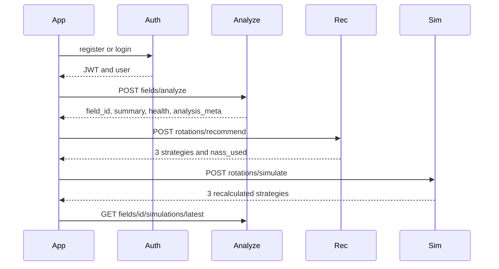

# NextHarvest API routes — payloads and app flow

Integration reference (Flutter, web, Space Apps demo). OpenAPI: [http://127.0.0.1:8000/docs](http://127.0.0.1:8000/docs).

- **Prefix:** `/api/v1`
- **Protection:** fields, diagnostics, rotations, and simulate require `Authorization: Bearer <access_token>`
- **Setup:** see [README.md](README.md) (Docker, `.env`, Swagger **Authorize**)

## Typical flow

Suggested order: **register/login** → **analyze** → (optional **diagnostics**) → **recommend** → **simulate** → **latest simulation** to restore sliders.

---

## Infrastructure (no login)

### `GET /health`

| | |
|---|---|
| **Auth** | No |
| **Returns** | `status` (`ok` \| `degraded`), `database` (`up` \| `down`), `redis` (`up` \| `down`) |

Deploy health check. `status` is `ok` only if Postgres **and** Redis respond.

---

## Authentication — `/api/v1/auth`

### `POST /api/v1/auth/register`

| | |
|---|---|
| **Body** | `name`, `email`, `password` (min 8 chars) |
| **Returns** | `access_token`, `token_type: bearer`, `user` (`id`, `name`, `email`) |
| **Errors** | **409** email taken; **503** database down |

### `POST /api/v1/auth/login`

| | |
|---|---|
| **Body** | `email`, `password` |
| **Returns** | Same as register |
| **Errors** | **401** invalid credentials |

### `GET /api/v1/auth/me`

| | |
|---|---|
| **Auth** | Bearer |
| **Returns** | `id`, `name`, `email` |

---

## Fields — `/api/v1/fields`

### `DELETE /api/v1/fields/{field_id}`

| | |
|---|---|
| **Auth** | Bearer; **owner** only |
| **Returns** | **204** empty body |
| **Effect** | Deletes field and `simulations` rows (ORM cascade) |
| **Errors** | **404**, **503** |

### `GET /api/v1/fields/` (or `GET /fields`)

| | |
|---|---|
| **Auth** | Bearer |
| **Returns** | `[{ id, name, current_crop }, …]` for the **current user** |

### `POST /api/v1/fields/analyze`

| | |
|---|---|
| **Auth** | Bearer |
| **Body** | `name`, `current_crop`, `geometry` (GeoJSON **Polygon** or Feature with Polygon) |
| **Engine** | NASA POWER (centroid), USDA SSURGO (polygon), OpenET (optional); GWETROOT proxy for moisture/bare months |
| **Persistence** | New `field_id`, PostGIS geometry, `last_summary`, `last_analysis_meta` |

**Response highlights**

| Field | Use |
|--------|-----|
| `field_id` | Key for diagnostics, recommend, simulate |
| `summary` | Harmonized diagnosis numbers + soil |
| `health` | Traffic-light UI |
| `analysis_meta` | Sources and failures (`et_source`, etc.) |
| `placeholder` | `false` when climate **and** soil OK |
| `message` | Human-readable English summary |

**`summary` (HarmonizedSummary)**

- `annual_precip_mm`, `annual_et_demand_mm`, `water_balance_deficit_mm`
- `soil_profile` — SSURGO map unit, OM, drainage, hydrologic group, K, AWC
- `smap_rootzone_anomaly_z` — with `rootzone_source: power_gwetroot` this is a **NASA POWER proxy**, not SMAP L4
- `bare_field_months` — English month names from POWER bare-soil proxy
- `rootzone_source` — `none` \| `power_gwetroot`

**`health`**

- `overall` — worst of water and soil dimensions
- `data_quality` — aligned with **sources**
- `dimensions[]` — `water`, `soil`, `sources`; each: `status` (`ok` \| `warning` \| `critical`) and English `label`

### `GET /api/v1/fields/{field_id}/simulations/latest`

| | |
|---|---|
| **Auth** | Bearer; owner |
| **Returns** | `id`, `created_at`, `simulation` (same schema as POST simulate) |
| **Errors** | **404** if never simulated or wrong owner |

---

## Diagnostics — `/api/v1/diagnostics`

### `GET /api/v1/diagnostics/{field_id}`

| | |
|---|---|
| **Auth** | Bearer; owner |
| **Engine** | Reads Postgres — **no** new NASA/USDA call |
| **Returns** | `summary`, `health`, `analysis_meta`, `placeholder`, `message` |

---

## Rotations — `/api/v1/rotations`

### `POST /api/v1/rotations/recommend`

| | |
|---|---|
| **Auth** | Bearer |
| **Body** | `field_id`, `priorities` (sliders 0–5, irrigation, machinery) |
| **Requires** | Field with stored analyze |
| **Engine** | FCC county, NASS (optional), `RotationEngine`, `AiExplainer` if `OPENAI_API_KEY` |

**Returns:** 3 `strategies` with 5-part `explanation`, `location`, `harmonized_summary`, `nass_used`, English `message`, `placeholder: false`.

### `POST /api/v1/rotations/simulate`

| | |
|---|---|
| **Auth** | Bearer |
| **Body** | `field_id`, `delta_precip_pct` (−30…+30), `delta_temp_c` (0…+4), optional `priorities` |
| **Engine** | In-memory climate adjust + `RotationEngine`; **no** NASA/OpenET/NASS/OpenAI |
| **Persistence** | `simulations` table |

**Returns:** adjusted deltas, 3 strategies, fixed English `message`, `placeholder: false`.

---

## Glossary — `/api/v1/glossary`

### `GET /api/v1/glossary/explain?term=...`

| | |
|---|---|
| **Auth** | No |
| **Returns** | `term`, `explanation`, `satellite_vs_in_situ`, `placeholder: true` |

---

## HTTP codes for the app

| Code | When |
|--------|--------|
| **401** | Missing/invalid token |
| **404** | Field/simulation missing or wrong user |
| **409** | Recommend/simulate without analyze; duplicate email |
| **503** | Database down |

---

## Optional `.env` keys

| Key | Effect |
|--------|--------|
| `OPENET_API_KEY` | `analysis_meta.et_source` = `openet` on analyze |
| `NASS_API_KEY` | `nass_used: true` on recommend |
| `OPENAI_API_KEY` | Rewritten explanations on recommend |

See “Before demo” in [README.md](README.md).