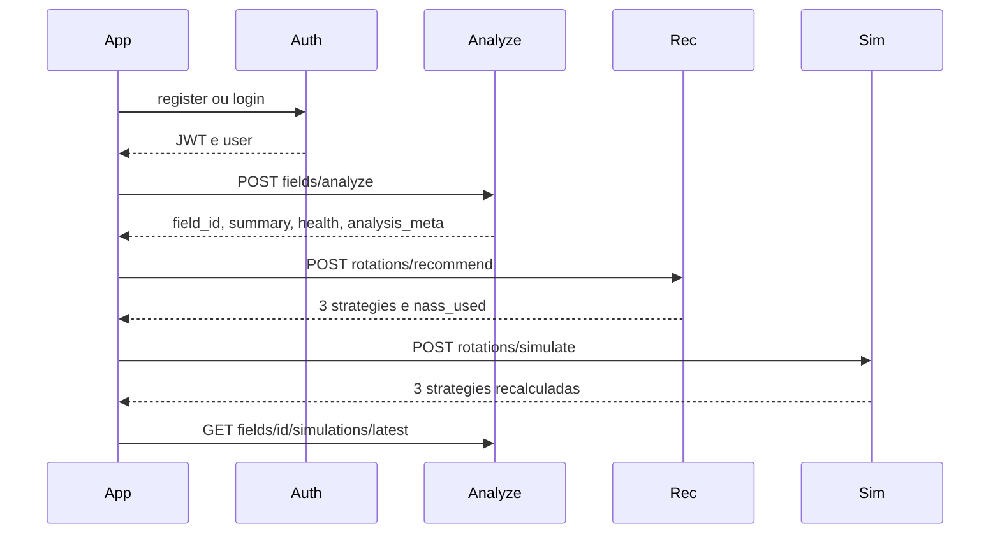

# Rotas da API NextHarvest — o que entregam e o que permitem fazer

Referência para integração (Flutter, web, demo Space Apps). Contrato OpenAPI: [http://127.0.0.1:8000/docs](http://127.0.0.1:8000/docs).

- **Prefixo:** `/api/v1`
- **Proteção:** talhões, diagnóstico, rotações e simulação exigem `Authorization: Bearer <access_token>`
- **Setup:** ver [README.md](README.md) (Docker, `.env`, Swagger **Authorize**)

## Fluxo típico

Ordem sugerida: **register/login** → **analyze** → (opcional **diagnostics**) → **recommend** → **simulate** → **latest simulation** para restaurar sliders.

---

## Infraestrutura (sem login)

### `GET /health`

| | |
|---|---|
| **Auth** | Não |
| **Entrega** | `status` (`ok` \| `degraded`), `database` (`up` \| `down`), `redis` (`up` \| `down`) |

**Possibilita:** health check de deploy e monitoramento. `status` só é `ok` se Postgres **e** Redis respondem; a API pode subir com um deles `down`, mas cadastro/analyze persistente falha se `database` estiver `down`.

---

## Autenticação — `/api/v1/auth`

### `POST /api/v1/auth/register`

| | |
|---|---|
| **Corpo** | `name`, `email`, `password` (mín. 8 caracteres) |
| **Entrega** | `access_token`, `token_type: bearer`, `user` (`id`, `name`, `email`) |
| **Erros** | **409** e-mail já cadastrado; **503** banco indisponível |

**Possibilita:** criar conta, guardar JWT (Keychain/Keystore) e chamar rotas protegidas.

### `POST /api/v1/auth/login`

| | |
|---|---|
| **Corpo** | `email`, `password` |
| **Entrega** | Igual ao register |
| **Erros** | **401** credenciais inválidas |

**Possibilita:** sessão em novo aparelho sem novo cadastro.

### `GET /api/v1/auth/me`

| | |
|---|---|
| **Auth** | Bearer |
| **Entrega** | `id`, `name`, `email` |

**Possibilita:** saudação na UI e validação de token.

---

## Talhões — `/api/v1/fields`

### `GET /api/v1/fields/` (ou `GET /fields`)

| | |
|---|---|
| **Auth** | Bearer |
| **Entrega** | Lista `[{ id, name, current_crop }, …]` dos talhões **do usuário** |

**Possibilita:** tela “Meus talhões”, escolher `field_id` para outras rotas. Talhões sem `user_id` (legado) não aparecem.

### `POST /api/v1/fields/analyze`

| | |
|---|---|
| **Auth** | Bearer |
| **Corpo** | `name`, `current_crop`, `geometry` (GeoJSON **Polygon** ou Feature com Polygon) |
| **Motor** | NASA POWER (centroide), USDA SSURGO (polígono), OpenET (opcional); proxy GWETROOT para umidade/meses de solo nu |
| **Persistência** | Novo `field_id`, geometria PostGIS, `last_summary`, `last_analysis_meta` |

**Entrega principal**

| Campo | Uso |
|--------|-----|
| `field_id` | Chave para diagnostics, recommend, simulate |
| `summary` | Diagnóstico harmonizado (números + solo) |
| `health` | Semáforos para UI |
| `analysis_meta` | Fontes e falhas (`et_source`, etc.) |
| `placeholder` | `false` se clima **e** solo OK |
| `message` | Resumo em português (complementar) |

**`summary` (HarmonizedSummary)**

- `annual_precip_mm`, `annual_et_demand_mm`, `water_balance_deficit_mm` — balanço hídrico anual.
- `soil_profile` — SSURGO: `mapunit_name`, matéria orgânica, drenagem, grupo hidrológico, fator K, AWC.
- `smap_rootzone_anomaly_z` — anomalia radicular; com `rootzone_source: power_gwetroot` é **proxy NASA POWER**, não SMAP L4.
- `bare_field_months` — meses (inglês) com proxy POWER de solo nu.
- `rootzone_source` — `none` \| `power_gwetroot`.

**`health`**

- `overall` — pior entre dimensões água e solo.
- `data_quality` — alinhado à dimensão **sources**.
- `dimensions[]` — `water`, `soil`, `sources`; cada uma: `status` (`ok` \| `warning` \| `critical`) e `label`.

**`analysis_meta`**

- `climate_ok`, `soil_ok`, `et_source` (`openet` \| `power` \| `none`), `failures` (lista de avisos).

**Possibilita:** cadastrar talhão, diagnóstico inicial, badges, timeline de solo nu (com legenda honesta), déficit hídrico. Se o banco falhar na gravação, a resposta 200 ainda traz diagnóstico com aviso no `message`.

### `GET /api/v1/fields/{field_id}/simulations/latest`

| | |
|---|---|
| **Auth** | Bearer; só o **dono** |
| **Entrega** | `id`, `created_at`, `simulation` (mesmo schema do POST simulate) |
| **Erros** | **404** se nunca houve simulate ou talhão de outro usuário |

**Possibilita:** restaurar sliders e resultado da última simulação sem estado só no cliente.

---

## Diagnóstico — `/api/v1/diagnostics`

### `GET /api/v1/diagnostics/{field_id}`

| | |
|---|---|
| **Auth** | Bearer; só o dono |
| **Motor** | Lê `last_summary` e meta no Postgres — **sem** nova chamada NASA/USDA |
| **Entrega** | `summary`, `health`, `analysis_meta`, `placeholder`, `message` |

**Possibilita:** tela de diagnóstico rápida após reopen do app. **404** talhão inexistente ou de outro usuário.

---

## Rotações — `/api/v1/rotations`

### `POST /api/v1/rotations/recommend`

| | |
|---|---|
| **Auth** | Bearer |
| **Corpo** | `field_id`, `priorities` (sliders 0–5, irrigação, maquinário) |
| **Pré-requisito** | Talhão com analyze gravado |
| **Motor** | FCC (condado), NASS (opcional), `RotationEngine`, `AiExplainer` (se `OPENAI_API_KEY`) |

**Entrega**

- **`strategies`** (3): `strategy_id`, `name`, `is_baseline`, `sequence`, `metrics_radar` (6 scores 0–100), `explanation` com as **5 seções** do desafio (por quê, evidências, benefícios, lacunas, riscos).
- **`location`**: lat, lon, `state`, `county`.
- **`harmonized_summary`**: diagnóstico usado no cálculo.
- **`nass_used`**: `true` se QuickStats devolveu dados.
- **`message`**: texto sobre ET, NASS e OpenAI.
- **`placeholder`**: `false` no fluxo normal.

**Possibilita:** comparador de ≥3 rotações, radar, cards auditáveis para juízes. **404** / **409** (sem analyze) / **503** (banco).

### `POST /api/v1/rotations/simulate`

| | |
|---|---|
| **Auth** | Bearer |
| **Corpo** | `field_id`, `delta_precip_pct` (−30…+30), `delta_temp_c` (0…+4), `priorities` (opcional — default demo Nevada) |
| **Motor** | Ajuste de clima em memória + `RotationEngine`; **sem** NASA, OpenET, NASS, **sem** OpenAI |
| **Persistência** | Grava em `simulations` |

**Entrega:** `delta_precip_pct`, `delta_temp_c`, `strategies` (3 recalculadas), `message` fixo, `placeholder: false`.

**Possibilita:** sliders de cenário (−25% chuva, +2 °C), comparar radar com o recommend. Textos das estratégias vêm do motor/templates, não da passagem LLM do recommend.

---

## Glossário — `/api/v1/glossary`

### `GET /api/v1/glossary/explain?term=...`

| | |
|---|---|
| **Auth** | Não |
| **Entrega** | `term`, `explanation`, `satellite_vs_in_situ`, `placeholder: true` |

**Possibilita:** tooltips (NDVI, ET, SMAP, grupo hidrológico). Termo desconhecido → texto genérico de “próxima fase”.

---

## Códigos HTTP úteis no app

| Código | Quando |
|--------|--------|
| **401** | Sem token ou token inválido |
| **404** | Talhão/simulação inexistente ou não é do usuário |
| **409** | Recommend/simulate sem analyze prévio; e-mail já registrado (register) |
| **503** | Banco indisponível (auth, analyze persistido, recommend com DB) |

---

## Chaves opcionais (`.env`)

| Chave | Efeito nas rotas |
|--------|------------------|
| `OPENET_API_KEY` | `analysis_meta.et_source` = `openet` no analyze |
| `NASS_API_KEY` | `nass_used: true` no recommend; scores de mercado |
| `OPENAI_API_KEY` | Explicações reescritas no recommend (`message` cita OpenAI) |

Ver checklist “Antes do demo” em [README.md](README.md).