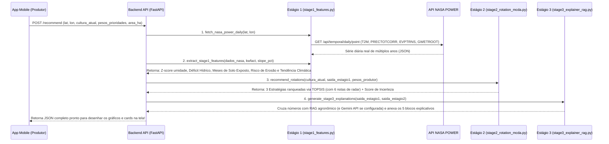

# Como o Pipeline de IA/SI (Estágios 1, 2 e 3) se Junta ao Backend e Como Testar

Este documento explica como os 3 estágios do **Pilar 4 (Motor Híbrido de Inteligência Sintética / IA)** funcionam em conjunto dentro da pasta `backend/` e como executar os testes automatizados e os testes fim-a-fim consultando a API oficial da NASA em tempo real.

---

## 1. Como os 3 Estágios se juntam ao Backend

Os três módulos em `backend/` formam um **pipeline sequencial de dados (Estágio 1 $\to$ Estágio 2 $\to$ Estágio 3)**. Na arquitetura do sistema, o servidor web do backend (por exemplo, um endpoint **FastAPI** como `POST /api/v1/rotations/recommend`) funciona como o "maestro" que recebe a requisição do aplicativo mobile e chama os 3 estágios em cascata:



### O papel exato de cada arquivo no código

#### 1. `stage1_features.py` (O Diagnóstico Ambiental)
* **`fetch_nasa_power_daily(lat, lon, start_year, end_year)`**: conecta na API oficial **NASA POWER** e baixa o histórico diário real de temperaturas máxima/mínima (`T2M_MAX`, `T2M_MIN`), precipitação (`PRECTOTCORR`), evapotranspiração (`EVPTRNS`) e umidade radicular do solo (`GWETROOT`).
* **`extract_stage1_features(...)`**: processa essa série temporal bruta e devolve um dicionário com os **4 indicadores biofísicos**:
  * `soil_moisture_anomaly_z`: anomalia da umidade do solo mês a mês ($Z$-score);
  * `crop_water_deficit_mm`: saldo hídrico mensal ($\text{Chuva} - \text{Evapotranspiração}$);
  * `bare_soil_months` e `seasonal_erosion_risk`: em quais meses do ano o solo fica vulnerável/descoberto e o índice de risco sazonal de erosão;
  * `climate_trends_per_year`: inclinação de **Theil-Sen** mostrando quantos dias quentes ($>35^\circ\text{C}$) e dias sem geada a fazenda está ganhando ou perdendo por ano.

#### 2. `stage2_rotation_mcda.py` (O Otimizador de Rotações)
* **`recommend_rotations(current_sequence, stage1, farmer_weights, ...)`**: recebe o diagnóstico do Estágio 1 + a sequência atual que o produtor planta (ex.: `["alfalfa", "alfalfa"]` ou `["corn", "corn"]`).
* Filtra rotações candidatas usando regras botânicas (`has_valid_family_succession` impede plantar duas gramíneas ou duas leguminosas seguidas para quebrar ciclos de pragas).
* Pontua cada rotação nos **6 eixos do gráfico de radar** (`water_efficiency_score`, `soil_health_organic_matter_score`, `nitrogen_fixation_score`, `erosion_protection_score`, `pest_cycle_disruption_score`, `market_viability_score`), penalizando culturas que gastam muita água quando o Estágio 1 aponta déficit hídrico e premiando culturas de cobertura de inverno quando há meses de solo exposto.
* Usa o método matemático **TOPSIS** ponderado pelas prioridades do produtor para devolver **3 estratégias**:
  1. `rot_baseline` (a rotação atual do produtor);
  2. `rot_water_resilient` (a melhor rotação para economizar água e proteger o solo);
  3. `rot_soil_market` (a melhor rotação para regenerar matéria orgânica/nitrogênio e atender às prioridades do produtor).
* Calcula também o objeto `uncertainty` (grau de incerteza de 0 a 100 baseado na diferença entre o tamanho do pixel do satélite da NASA e o tamanho em hectares da fazenda, cobertura de nuvens e presença de análise laboratorial local).

#### 3. `stage3_explainer_rag.py` (O Tradutor Agronômico Explicável)
* **`generate_stage3_explanations(stage1, stage2)`**: pega os números dos Estágios 1 e 2, busca referências técnicas no `KNOWLEDGE_BASE` (USDA NRCS, FAO GAEZ, NASA Earthdata) e preenche para cada uma das 3 estratégias os **5 campos obrigatórios exigidos pelo regulamento do NASA Space Apps**:
  1. `why_suggested` (Por que foi sugerida)
  2. `supporting_evidence` (Evidências da NASA e USDA que comprovam)
  3. `expected_benefits` (Benefícios esperados)
  4. `information_gaps_and_uncertainty` (Lacunas dos dados de satélite)
  5. `risks_requiring_local_review` (Riscos que exigem validação com engenheiro agrônomo local)
* Se a variável de ambiente `GEMINI_API_KEY` estiver definida, ele usa o modelo **Gemini 2.5 Flash** com *Structured Outputs* (garantindo o mesmo formato JSON validado pelo Pydantic) para redigir textos ainda mais personalizados. Sem a chave, ele gera as explicações de forma 100% local e determinística.

---

## 2. Como Testar se Está Funcionando

Execute os comandos abaixo no terminal PowerShell a partir da pasta raiz do projeto (`c:\projects\nextharvest`):

### Teste A: Suíte de Testes Unitários Automatizados (`pytest`)
Valida rapidamente (em menos de 1 segundo, sem precisar de internet) todas as fórmulas matemáticas, filtros botânicos, ranking TOPSIS e contratos JSON:

```powershell
.\.venv\Scripts\pytest.exe backend
```
*(Resultado esperado: `9 passed` — 3 testes do Estágio 1, 3 do Estágio 2 e 3 do Estágio 3).*

### Teste B: Teste Real Fim-a-Fim Consultando a API da NASA ao Vivo
O comando abaixo consulta a **API real da NASA POWER** para uma fazenda em **Fallon, Nevada** (`lat=39.473, lon=-118.777`, região produtora de alfafa que inspirou o desafio da NASA) — ou você pode trocar pelas coordenadas de qualquer fazenda no Brasil (ex.: Sorriso-MT `lat=-12.54, lon=-55.72`) — e passa os dados pelos Estágios 1, 2 e 3:

```powershell
.\.venv\Scripts\python.exe -c "import json, sys; sys.path.insert(0, 'backend'); from stage1_features import fetch_nasa_power_daily, extract_stage1_features; from stage2_rotation_mcda import recommend_rotations; from stage3_explainer_rag import generate_stage3_explanations; raw = fetch_nasa_power_daily(39.473, -118.777, 2021, 2025); s1 = extract_stage1_features(raw); s2 = recommend_rotations(['alfalfa', 'alfalfa'], s1, field_area_ha=25.0); s3 = generate_stage3_explanations(s1, s2); print(json.dumps(s3, ensure_ascii=False, indent=2))"
```

#### Exemplo do Resultado Retornado ao Vivo pela NASA + Pipeline IA:
* **Estágio 1 detecta automaticamente:** Anomalia de umidade radicular $Z = -1,06$ (seca na raiz), 5 meses críticos de solo vulnerável (`[5, 6, 7, 8, 9]`) e tendência climática de $+7,62$ dias livres de geada por ano entre 2021 e 2025.
* **Estágio 2 recomenda:** Substituir a monocultura `Alfafa → Alfafa` pela rotação `Sorgo Tolerante à Seca → Centeio + Ervilhaca (Cobertura) → Grão-de-Bico` (elevando a nota de eficiência hídrica para **91/100**, proteção contra erosão para **88/100** e quebra de pragas para **100/100**, com score TOPSIS de **81,95**).
* **Estágio 3 anexa:** As 5 listas estruturadas de justificativas, evidências da NASA/USDA, lacunas de escala (avisando que o pixel de $9\text{ km}^2$ é $36\times$ maior que o talhão de $25\text{ ha}$) e recomendações de revisão agronômica local.
