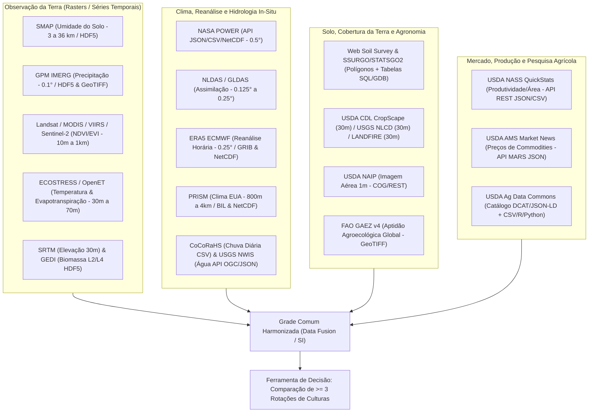

# Relatório Técnico Completo: Recursos e Estrutura de Dados — *Field Shift: Adapting Farms with NASA Data* (NASA Space Apps 2026)

Este relatório apresenta o levantamento completo extraído via **Scrapling** da página oficial do desafio [**Field Shift: Adapting Farms with NASA Data**](https://www.spaceappschallenge.org/2026/challenges/adapting-farms-with-nasa-data/?tab=resources) e de todos os **26 links (24 plataformas/conjuntos de dados)** listados na aba *Resources*.

---

## 1. Visão Geral do Desafio e Requisitos de Dados

* **Título Oficial:** *Field Shift: Adapting Farms with NASA Data*
* **Nível de Dificuldade:** Intermediário / Avançado
* **Habilidades Envolvidas:** *Earth Science*, *Software*, *Arts & Multimedia*
* **Objetivo Central:** Criar uma ferramenta de apoio à decisão (aplicação, modelo de Inteligência Sintética/IA, mapa interativo) que combine observações da Terra da NASA com informações locais de solo, características das culturas e prioridades do produtor rural para comparar **pelo menos três estratégias de rotação de culturas** (incluindo a rotação atual), fortalecendo a saúde do solo e a resiliência hídrica e climática.

> [!IMPORTANT]
> **Requisito Técnico de Harmonização (Data Fusion):** A página do desafio destaca explicitamente a necessidade de **harmonizar conjuntos de dados com diferentes resoluções espaciais e temporais** (via *downsampling*, agregação ou reamostragem para uma grade comum de análise), permitindo cruzar séries temporais de satélite (SMAP, ECOSTRESS, GPM, Landsat/MODIS/Sentinel-2, GEDI) com dados vetoriais/tabulares de solo (SSURGO), clima local (PRISM, NASA POWER, ERA5) e economia agrícola (USDA NASS/AMS).



---

## 2. Análise Detalhada: *NASA Data & Resources* (24 Links / 22 Fontes)

Abaixo está o detalhamento completo do que cada site/link oferece e **como seus dados são estruturados** (arquivos, níveis de processamento, projeções, esquemas internos e APIs).

---

### 2.1. Soil Moisture Active Passive (SMAP)
* **Link Oficial:** [NASA Earthdata — SMAP Platform](https://www.earthdata.nasa.gov/data/platforms/space-based-platforms/smap) *(Distribuído via NSIDC DAAC e ASF DAAC)*
* **O que oferece:**
  * Medições globais diretas de **umidade superficial do solo** (camada superior de ~5 cm), **umidade na zona radicular** (até 100 cm em produtos assimilados L4) e **estado de congelamento/degelo (Freeze/Thaw)**.
  * **Cobertura e Frequência:** Global, com revisita a cada **2 a 3 dias** (desde abril de 2015).
  * **Aplicação no Desafio:** Identificar estresse hídrico precoce, capacidade de infiltração, déficit de água no solo e avaliar culturas de rotação resistentes à seca.
* **Como os dados são estruturados:**
  * **Formato Padrão:** **HDF5 (`.h5`)** compatível com CF Metadata Conventions (também exportável como **GeoTIFF** ou **NetCDF-4** via NASA AppEEARS e Earthdata Search).
  * **Hierarquia de Níveis e Produtos Principais:**
    * **Nível 1 (`L1B_TB`, `L1C_TB`):** Temperatura de brilho calibrada do radiômetro (36 km).
    * **Nível 2 (`SPL2SMP` / `SPL2SMP_E`):** Umidade do solo em meia-órbita (*swath*), postado em grade de **36 km** (padrão) e **9 km** (*Enhanced*, interpolado por Backus-Gilbert).
    * **Nível 3 (`SPL3SMP`, `SPL3SMP_E`, `SPL3FTA`):** Compósitos diários globais de umidade do solo (**36 km** e **9 km**) e estado de congelamento/degelo (**3 km**).
    * **Nível 4 (`SPL4SMGP`, `SPL4SMAU`):** Produto de assimilação de modelo de superfície terrestre em grade de **9 km** a cada **3 horas**, fornecendo `sm_surface` (0–5 cm) e `sm_rootzone` (0–100 cm) sem lacunas orbitais.
  * **Projeção e Grade:** **EASE-Grid 2.0** (*Equal-Area Scalable Earth Grid 2.0* — projeção cilíndrica de área igual global `EPSG:6933` ou polar norte `EPSG:6931`).
  * **Estrutura Interna do Arquivo HDF5 (ex.: `SPL3SMP_E`):**
    * Grupos separados por passagem orbital: `/Soil_Moisture_Retrieval_Data_AM/` (passagem descendente 6h local) e `/Soil_Moisture_Retrieval_Data_PM/` (passagem ascendente 18h local).
    * Variáveis principais (matrizes 2D `Float32`): `soil_moisture` ($\text{cm}^3/\text{cm}^3$, faixa válida `0.02` a `0.50`, `_FillValue = -9999.0`), `soil_moisture_error`, `retrieval_qual_flag` (máscara de bits `UInt16` indicando qualidade, presença de água, gelo ou vegetação densa), `vegetation_water_content` ($\text{kg/m}^2$), `surface_temperature` (K), `latitude` e `longitude`.
  * **Acesso Programático:** Earthdata Cloud (acesso direto S3 no bucket `nsidc-cumulus-prod-protected` na região `us-west-2`), API REST `earthaccess` (Python), OPeNDAP e **NASA AppEEARS** (para extração de séries temporais em JSON/CSV para pontos ou polígonos).

---

### 2.2. Global Precipitation Measurement (GPM) & IMERG
* **Link Oficial:** [NASA GPM Data Directory](https://gpm.nasa.gov/data) *(Distribuído principalmente via GES DISC)*
* **O que oferece:**
  * Estimativas globais de **taxa de precipitação** ($\text{mm/hr}$) e **acumulado de chuva/neve** ($\text{mm}$), combinando toda a constelação de satélites de micro-ondas passivas, infravermelho geoestacionário e calibração por pluviômetros de superfície (sucedendo a missão TRMM, com série histórica unificada desde **junho de 2000 até o presente**).
  * **Aplicação no Desafio:** Avaliar confiabilidade das chuvas, frequência de tempestades extremas, risco de erosão hídrica e entrada de água no balanço hídrico das rotações.
* **Como os dados são estruturados:**
  * **Produtos IMERG (*Integrated Multi-satellitE Retrievals for GPM* — Versão 07 / transição V08):**
    * **IMERG Early Run (`GPM_3IMERGHHE`):** Latência de ~4 horas (para alertas rápidos).
    * **IMERG Late Run (`GPM_3IMERGHHL`):** Latência de ~14 horas (usado em monitoramento agrícola e previsão de safra).
    * **IMERG Final Run (`GPM_3IMERGHH` / Diário `GPM_3IMERGDF` / Mensal `GPM_3IMERGM`):** Latência de ~3,5 meses, calibrado com dados de pluviômetros do GPCC (recomendado para análise histórica e treinamento de IA).
  * **Resolução Espacial e Temporal:** Grade global de **$0,1^\circ \times 0,1^\circ$** (~10 km $\times$ 10 km) em intervalos de **30 minutos**, **diários** ou **mensais**.
  * **Formatos Disponíveis:**
    1. **HDF5 (`.HDF5`)** e **NetCDF-4 (`.nc4`)** no GES DISC.
    2. **GeoTIFF (`.tif`)** de 1 dia, 3 dias, 7 dias e 30 minutos no servidor PPS GIS (`jsimpsonhttps.pps.eosdis.nasa.gov`).
    3. **Imagens PNG/JPEG/GeoTIFF via NASA Worldview / GIBS** (WMTS/TWMS).
  * **Projeção:** Grade geográfica regular Equirretangular **WGS84 (`EPSG:4326`)**, matriz de $3600 \text{ (lon)} \times 1800 \text{ (lat)}$.
  * **Estrutura Interna do Arquivo HDF5/NetCDF (`3B-HHR` / `3B-DAY`):**
    * Grupo `/Grid/`:
      * `precipitation` (ou `precipitationCal` na V06): taxa ou acumulado de precipitação calibrada (`Float32`, dimensão `[time, lon, lat]`).
      * `randomError`: erro estimado da precipitação.
      * `probabilityLiquidPrecipitation`: percentual (0–100%) indicando se a precipitação é líquida (chuva) ou sólida (neve/granizo).
      * `precipitationQualityIndex`: índice de qualidade do algoritmo.
  * **Acesso Programático:** OPeNDAP (permite fatiar subset espacial/temporal via URL retornando `.nc4` ou `.ascii`), Giovanni API, NASA Earthdata Cloud S3 (`gesdisc-cumulus-prod-protected`) e Google Earth Engine (`NASA/GPM_L3/IMERG_V07`).

---

### 2.3. Landsat (USGS EarthExplorer) & MODIS / VIIRS (LP DAAC & Earthdata Search)
A página agrupa três links sob o item **Landsat and MODIS/VIIRS: Reflectance, NDVI, Vegetation Indices**:
1. **Landsat:** [USGS EarthExplorer](https://earthexplorer.usgs.gov/)
2. **MODIS:** [USGS/NASA LP DAAC Products](https://lpdaac.usgs.gov/products/) *(redireciona para o catálogo LP DAAC na NASA Earthdata)*
3. **VIIRS:** [NASA Earthdata Search — VIIRS](https://search.earthdata.nasa.gov/search?q=VIIRS)

* **O que oferecem:**
  * Reflectância de superfície corrigida atmosfericamente (*Surface Reflectance*), Índices de Vegetação (**NDVI** — *Normalized Difference Vegetation Index* e **EVI** — *Enhanced Vegetation Index*), Índice de Área Foliar (**LAI**), Fração da Radiação Fotossinteticamente Ativa Absorvida (**FPAR**) e Temperatura de Superfície (**LST**).
  * **Resolução Espacial e Temporal:**
    * **Landsat 8/9 (OLI/TIRS):** **30 metros** (óptico/SWIR) e 100 m reamostrado a 30 m (termal), revisita de **8 dias** combinando Landsat 8 e 9 (16 dias por satélite), arquivo histórico desde 1972 (30 m desde 1982 com Landsat 4).
    * **MODIS (Terra/Aqua):** **250 m** (bandas 1–2: Red/NIR e NDVI/EVI), **500 m** (bandas 3–7: SWIR e LAI/FPAR) e **1000 m** (LST/Evapotranspiração), revisita **diária** (compósitos de 8 dias ou 16 dias livres de nuvens).
    * **VIIRS (Suomi NPP, NOAA-20, NOAA-21):** **375 m** (bandas *Imagery* I1–I5) e **750 m** (bandas *Moderate* M1–M11), sucessor operacional do MODIS (nota: a própria página da Earthdata alerta que o Suomi NPP está sendo substituído pelos satélites NOAA-20/JPSS-1 e NOAA-21/JPSS-2).
* **Como os dados são estruturados:**
  * **Landsat Collection 2 Level-2 (`LC08_L2SP` / `LC09_L2SP`):**
    * **Formato:** **Cloud-Optimized GeoTIFF (COG)** — cada banda espectral é um arquivo `.TIF` independente acompanhado de metadados em **JSON (`_MTL.json`)**, **XML (`_MTL.xml`)** e descritor **STAC**.
    * **Projeção e Indexação:** Projeção **UTM (WGS84)** dividida pelo sistema de referência mundial **WRS-2 (`Path` / `Row`)** ou grade **ARD Tiles** (*Analysis Ready Data*).
    * **Estrutura das Bandas e Escalonamento:**
      * `SR_B1` a `SR_B7` (`UInt16`): Reflectância de Superfície. Para converter para valor físico real: $\text{SR} = \text{DN} \times 0.0000275 - 0.2$.
      * `ST_B10` (`UInt16`): Temperatura de Superfície em Kelvin ($\text{ST} = \text{DN} \times 0.00341802 + 149.0$).
      * `QA_PIXEL` (`UInt16`): Bitmask de nuvens, sombra de nuvem, neve e água.
  * **MODIS Collection 6.1 (ex.: `MOD13Q1` / `MYD13Q1` — Índices de Vegetação 250 m, 16 dias):**
    * **Formato:** **HDF-EOS2 (`.hdf`)** (ou GeoTIFF/NetCDF-4 quando extraído via AppEEARS).
    * **Projeção e Indexação:** **Projeção Sinusoidal** dividida em tiles globais de $10^\circ \times 10^\circ$ identificados por `hXXvYY` (horizontal `00–35`, vertical `00–17`, cada tile com $4800 \times 4800$ pixels em 250 m).
    * **Camadas Internas (SDS — *Scientific Data Sets*):** `250m 16 days NDVI` (`Int16`, fator de escala `0.0001`), `250m 16 days EVI`, `250m 16 days VI Quality` (bitmask), reflectâncias `red`, `NIR`, `blue`, `MIR`, e `250m 16 days composite day of the year`.
  * **VIIRS Collection 2 (ex.: `VNP13A1` — 500 m, 16 dias / `VNP09GA` — Reflectância Diária):**
    * **Formato:** **HDF-EOS5 / HDF5 (`.h5`)**, mantendo o mesmo esquema de tiles Sinusoidais `hXXvYY` do MODIS para continuidade de séries temporais.
    * **Dica Extra da NASA Earthdata:** O produto **HLS (*Harmonized Landsat and Sentinel-2*, `HLSL30` e `HLSS30`)** no LP DAAC já entrega Landsat 8/9 e Sentinel-2 harmonizados em **COG de 30 m** na mesma grade MGRS a cada **2–3 dias**.

---

### 2.4. NASA POWER (Prediction Of Worldwide Energy Resources)
* **Link Oficial:** [NASA POWER Portal](https://power.larc.nasa.gov/)
* **O que oferece:**
  * Mais de **300 parâmetros agroclimatológicos, solares e meteorológicos** prontos para análise (*Analysis-Ready Data*), cobrindo desde **1981 até quase o tempo real** (latência de 2 a 5 dias para meteorologia e ~2 meses para radiação solar final).
  * **Parâmetros Críticos para Agricultura (`community=AG`):** Temperatura a 2 m (`T2M`, `T2M_MAX`, `T2M_MIN`), Ponto de Orvalho/Geada (`T2MDEW`, `FROST_DAYS`), Precipitação Corrigida (`PRECTOTCORR`), Umidade Relativa (`RH2M`), Velocidade do Vento (`WS2M`), Radiação Solar de Ondas Curtas (`ALLSKY_SFC_SW_DWN` — essencial para cálculo de fotossíntese e evapotranspiração de Penman-Monteith) e Umidade do Solo superficial e radicular (`GWETTOP`, `GWETROOT`, `GWETPROF`).
* **Como os dados são estruturados:**
  * **Resolução Espacial:** Grade global de **$0,5^\circ \times 0,625^\circ$** (~50 km $\times$ 60 km) para variáveis meteorológicas (derivadas do modelo **MERRA-2**) e **$1,0^\circ \times 1,0^\circ$** para variáveis solares (derivadas do GEWEX SRB / CERES).
  * **Resolução Temporal:** **Horária** (`hourly`), **Diária** (`daily`), **Mensal** (`monthly`) e **Climatologia** (`climatology` — médias de 30 anos).
  * **Formatos e API REST (Sem necessidade de chave/autenticação!):**
    * **Endpoint REST Direto:** `https://power.larc.nasa.gov/api/temporal/{frequency}/point?parameters=T2M,PRECTOTCORR,GWETROOT&community=AG&longitude={lon}&latitude={lat}&start={YYYYMMDD}&end={YYYYMMDD}&format={JSON|CSV|NETCDF|GEOJSON|ASCII}`
    * **Estrutura do JSON retornado:**
      ```json
      {
        "type": "Feature",
        "geometry": { "type": "Point", "coordinates": [-47.92, -15.78, 1050.0] },
        "header": { "title": "NASA/POWER CERES/MERRA2 Native Resolution Daily Data", "fill_value": -999.0 },
        "properties": {
          "parameter": {
            "T2M": { "20260101": 24.5, "20260102": 25.1 },
            "PRECTOTCORR": { "20260101": 12.4, "20260102": 0.0 },
            "GWETROOT": { "20260101": 0.68, "20260102": 0.65 }
          }
        }
      }
      ```
    * **Datastore Direto na Nuvem (AWS Open Data):** Cubos globais em formato **Zarr** e **NetCDF-4** hospedados no bucket S3 público `s3://power-analysis-ready-datastore/` para leitura direta com `xarray` e `fsspec` em Python.

---

### 2.5. Shuttle Radar Topography Mission (SRTM)
* **Link Oficial:** [NASA Earthdata — SRTM Instrument](https://www.earthdata.nasa.gov/data/instruments/srtm)
* **O que oferece:**
  * **Modelos Digitais de Elevação (DEM)** quase globais (entre $60^\circ\text{N}$ e $56^\circ\text{S}$, cobrindo ~80% da superfície terrestre) obtidos por interferometria de radar nas bandas C e X em fevereiro de 2000 (e aprimorados no produto **NASADEM**).
  * **Aplicação no Desafio:** Calcular declividade (*slope*), orientação de vertentes (*aspect* — exposição solar), índice topográfico de umidade (*Topographic Wetness Index - TWI*), direção de escoamento superficial (*runoff*) e risco de erosão laminar em encostas para recomendar culturas de cobertura ou terraceamento.
* **Como os dados são estruturados:**
  * **Produtos Principais (LP DAAC):**
    * `SRTMGL1` (Versão 3.0) e `NASADEM_HGT`: Resolução de **1 segundo de arco (~30 metros no equador)**.
    * `SRTMGL3`: Resolução de **3 segundos de arco (~90 metros)**.
  * **Projeção e Recorte (Tiling):** Coordenadas geográficas **WGS84 (`EPSG:4326`)** com datum vertical **EGM96** (altura ortométrica em metros). Os arquivos são recortados em quadrículas de **$1^\circ \times 1^\circ$** nomeadas pelo canto sudoeste (ex.: `S23W048.SRTMGL1.hgt.zip` ou `N39W119.hgt`).
  * **Formato Binário `.hgt` / GeoTIFF:**
    * O arquivo `.hgt` de 1 segundo de arco é uma matriz binária pura de **$3601 \times 3601$ inteiros de 16 bits com sinal (`Int16`, *big-endian*)**, representando a elevação em metros (sem cabeçalho; valores `-32768` indicam vazio/void).
    * Também disponível diretamente como **GeoTIFF (`.tif`)** ou **NetCDF** via OpenTopography, AppEEARS e Earthdata Search.

---

### 2.6. ECOSTRESS (Ecosystem Spaceborne Thermal Radiometer Experiment on Space Station)
* **Link Oficial:** [JPL NASA — ECOSTRESS Data](https://ecostress.jpl.nasa.gov/data)
* **O que oferece:**
  * Medições termais de altíssima resolução espacial feitas a bordo da Estação Espacial Internacional (ISS) desde julho de 2018.
  * Fornece **Temperatura da Superfície Terrestre (LST)**, **Evapotranspiração Instantânea e Diária (ET)**, **Índice de Estresse Hídrico Evaporativo (ESI)** e **Eficiência no Uso da Água pelas Plantas (WUE)**.
  * **Diferencial Único:** Como a ISS possui órbita precessional não-heliossíncrona, o ECOSTRESS passa sobre o mesmo talhão em **diferentes horários do dia**, permitindo capturar o estresse térmico das plantas no meio da tarde (quando o fechamento estomático ocorre), algo que satélites matinais não detectam.
* **Como os dados são estruturados:**
  * **Resolução Espacial:** **~$70\text{ m} \times 70\text{ m}$** (produtos Nível 2/3/4 da **Collection 2** já vêm reamostrados e projetados em grade de **70 m** ou **30 m** harmonizados com HLS).
  * **Estrutura dos Produtos Collection 2 (LP DAAC — todos os produtos L2T/L3T/L4T em grade são entregues como Cloud-Optimized GeoTIFFs `.tif` dentro de granules STAC, enquanto L1B/L2 swath são HDF5 `.h5`):**
    * **`ECO_L2T_LSTE`:** Temperatura de Superfície e Emissividade em tiles UTM de 70 m. Bandas GeoTIFF separadas: `*_LST.tif` (Kelvin), `*_LST_err.tif`, `*_QC.tif`, `*_EmisWB.tif`, `*_cloud.tif`.
    * **`ECO_L2T_STARS`:** Fusão de dados VIIRS + HLS (Landsat/Sentinel-2) gerando **NDVI** e **Albedo** na mesma resolução de 70 m para alimentar os modelos de ET.
    * **`ECO_L3T_JET` (JPL Evapotranspiration Ensemble):** Evapotranspiração em 70 m combinando os modelos PT-JPL, PM-MOD, STIC e SEBAL (camadas de ET diária em $\text{mm/dia}$ e fluxo de calor latente em $\text{W/m}^2$).
    * **`ECO_L3T_MET` e `ECO_L3T_SM`:** Dados meteorológicos (GEOS-5) e umidade do solo (SMAP) reamostrados (*downscaled*) para 70 m.
    * **`ECO_L4T_ESI` e `ECO_L4T_WUE`:** Índice de Estresse Evaporativo (`ESI`, razão entre ET real e potencial de `0.0` a `1.0`) e Eficiência no Uso da Água (`WUE`, em $\text{g C / kg H}_2\text{O}$).
  * **Projeção (Collection 2 Tiled Products):** Grade **UTM / MGRS** (idêntica aos tiles do Sentinel-2 / HLS), facilitando o empilhamento direto pixel a pixel com Sentinel-2 e Landsat.

---

### 2.7. USDA Ag Data Commons
* **Link Oficial:** [USDA National Agricultural Library — Ag Data Commons](https://www.nal.usda.gov/services/agdatacommons) *(Catálogo em `agdatacommons.nal.usda.gov`)*
* **O que oferece:**
  * Repositório central de dados abertos de pesquisas financiadas pelo USDA (ARS, NIFA, ERS, NRCS, FS).
  * Contém milhares de datasets experimentais de campo: ensaios de longo prazo de **rotação de culturas** (ex.: *Long-Term Agroecosystem Research - LTAR*, *Gracenet*), análises microbiológicas e químicas do solo, emissões de gases de efeito estufa agrícolas, fenologia, manejo de culturas de cobertura e qualidade da água.
* **Como os dados são estruturados:**
  * **Estrutura de Metadados do Catálogo:** Padrão federal **Project Open Data Metadata Schema v1.1 (DCAT-US / JSON-LD)** e **DataCite**, com identificadores **DOI** persistentes para cada dataset.
  * **Estrutura dos Arquivos de Dados:**
    * Como é um repositório de dados científicos tabulares e geoespaciais de pesquisa, cada publicação inclui:
      1. **Tabelas de Dados:** Arquivos **CSV (`.csv`)**, **TSV**, **Excel (`.xlsx`)** ou bancos **SQLite**.
      2. **Dicionário de Dados (*Data Dictionary*):** Arquivo CSV/JSON ou documentação README descrevendo cada coluna, unidade de medida (SI), códigos de tratamento agronômico e valores nulos.
      3. **Dados Espaciais/Scripts:** *Shapefiles*, *GeoJSON*, *GeoTIFF* e scripts em **R / Python**.
  * **Acesso Programático:** API REST compatível com CKAN/InvenioRDM e download direto via HTTPS.

---

### 2.8. Web Soil Survey (WSS) & 2.9. USDA NRCS SSURGO / STATSGO2
A página apresenta dois links complementares para a base oficial de solos dos Estados Unidos:
1. **Aplicação Interativa:** [Web Soil Survey (WSS)](https://websoilsurvey.nrcs.usda.gov/app/)
2. **Portal de Dados Brutos e Relatórios:** [USDA NRCS Soils Data](https://www.nrcs.usda.gov/resources/data-and-reports/soils)

* **O que oferecem:**
  * O maior banco de dados pedológicos de escala de propriedade rural do mundo, cobrindo >95% dos condados dos EUA:
    * **SSURGO (*Soil Survey Geographic Database*):** Escala de campo/fazenda (1:12.000 a 1:24.000).
    * **STATSGO2 (*State Soil Geographic Database*):** Escala regional/estadual (1:250.000).
    * **gSSURGO / gNATSGO:** Versão rasterizada em grade de **10 metros** e **30 metros**.
  * **Atributos Fornecidos:** Textura do solo (% areia, silte, argila), matéria orgânica (`om_r`), pH (`ph1to1h2o_r`), capacidade de troca catiônica (`cec7_r`), capacidade de água disponível (`awc_r`), condutividade hidráulica saturada (`ksat_r`), classe de drenagem (`drainagecl`), grupo hidrológico do solo (`hydgrp` A/B/C/D), fatores de erodibilidade K e T (`kwfact`, `tfact`), salinidade (`ec_r`), profundidade até camada restritiva/rocha e índices de produtividade agrícola (*National Commodity Crop Productivity Index - NCCPI*).
* **Como os dados são estruturados (Arquitetura Relacional Hierárquica 1:N):**
  * Os dados do SSURGO/WSS **não** guardam todas as propriedades na tabela de polígonos! Eles usam um esquema relacional normalizado de 3 níveis principais (mais de 70 tabelas no total):
    1. **Nível Espacial (`mupolygon` + tabela `mapunit`):** Polígonos geográficos identificados pela chave primária **`mukey`** (*Map Unit Key*). Uma unidade de mapeamento (`mapunit`) contém o nome do solo (`muname`), declividade geral e grupo hidrológico dominante (`muaggatt` — tabela agregada 1:1 com `mukey` para consultas rápidas).
    2. **Nível de Componente (`component`, chave `cokey`, ligada a `mukey`):** Cada polígono `mukey` é composto por 1 ou mais tipos de solo (`compname`, com percentual `comppct_r` da área, classe de drenagem `drainagecl`, classificação taxonômica e declividade `slope_r`).
    3. **Nível de Horizonte/Profundidade (`chorizon`, chave `chkey`, ligada a `cokey`):** Cada componente `cokey` possui múltiplas camadas verticais de profundidade (`hzdept_r` a `hzdepb_r` em cm, ex.: 0–15 cm, 15–60 cm, 60–150 cm), onde ficam os valores numéricos de argila (`claytotal_r`), areia (`sandtotal_r`), silte (`silttotal_r`), matéria orgânica (`om_r`), pH, densidade aparente (`dbthirdbar_r`) e retenção de água (`awc_r`). Nota: cada propriedade numérica traz 3 colunas: `*_l` (*low*), `*_r` (*representative value*) e `*_h` (*high*).
  * **Formatos de Download e APIs:**
    * **Download via WSS:** Pacote `.zip` contendo uma pasta `spatial/` (**Shapefiles** dos polígonos `soilmu_a_*.shp`) e uma pasta `tabular/` (arquivos texto delimitados por pipe `|` para importar em banco MS Access/SQLite/PostgreSQL).
    * **gSSURGO / gNATSGO:** **Esri File Geodatabase (`.gdb`)** ou GeoTIFF de 30 m com `mukey` como valor do pixel.
    * **API Pública (Soil Data Access — SDA REST/SQL):** Endpoint `https://SDMDataAccess.sc.egov.usda.gov/Tabular/post.rest` que aceita consultas **T-SQL + funções espaciais WKT** (ex.: passar o polígono ou `POINT(lon lat)` da fazenda e fazer `JOIN` entre `mapunit`, `component` e `chorizon`) e retorna diretamente **JSON** ou **XML** sem precisar baixar gigabytes de shapefiles!

---

### 2.10. Cropland Data Layer (CDL): CropScape
* **Link Oficial:** [USDA NASS CropScape](https://nassgeodata.gmu.edu/CropScape/) *(Alternativa de download direto: [USDA NASS CDL](https://www.nass.usda.gov/Research_and_Science/Cropland/Release/index.php))*
* **O que oferece:**
  * Mapa anual classificado em alta resolução (**30 metros**) de todas as culturas agrícolas plantadas nos Estados Unidos continentais (CONUS), atualizado anualmente desde 1997 (cobertura completa dos 48 estados desde **2008 até o presente**).
  * Identifica mais de **130 classes específicas de uso do solo e culturas**, como milho (`1`), algodão (`2`), arroz (`3`), sorgo (`4`), soja (`5`), girassol (`6`), trigo de primavera/inverno (`23`/`24`), alfafa (`36`), pousio/solo exposto (`61` — *Fallow/Idle Cropland*), além de classes de **duplo cultivo** (*Double Crop*, ex.: trigo de inverno seguido de soja `26`).
  * **Aplicação no Desafio:** Extrair automaticamente o **histórico real de rotação de culturas de qualquer talhão** nos últimos 15+ anos (ex.: detectar se o produtor fez monocultura Milho–Milho ou rotação Milho–Soja–Alfafa) e treinar modelos de IA com rótulos de cultura verificados.
* **Como os dados são estruturados:**
  * **Formato:** **GeoTIFF (`.tif`)** de banda única indexada por paleta de cores (*8-bit unsigned integer* `UInt8`, valores de `0` a `254`).
  * **Projeção:** **Albers Equal Area Conic (`EPSG:5070` — NAD83 / Conus Albers)** com pixels exatos de $30\text{ m} \times 30\text{ m}$ alinhados à grade do NLCD e do Landsat ARD.
  * **Tabela de Atributos Raster (VAT):** Cada número inteiro de `1` a `254` corresponde a uma cultura ou classe de cobertura terrestre padronizada (ex.: `1 = Corn`, `5 = Soybeans`, `24 = Winter Wheat`, `36 = Alfalfa`, `61 = Fallow/Idle Cropland`, `176 = Grassland/Pasture`).
  * **Produtos Derivados de Frequência de Culturas (*Crop Frequency Layers*):** GeoTIFFs de 30 m indicando quantos anos nos últimos $N$ anos um pixel foi plantado com milho, soja, algodão ou trigo.
  * **Acesso Programático:** Web Services OGC (**WMS, WCS, WFS**) e REST API do CropScape (permite enviar um polígono ou coordenada e receber o JSON/CSV com a estatística de área de cada cultura por ano), além de Google Earth Engine (`USDA/NASS/CDL`) e Microsoft Planetary Computer (`usda-cdl`).

---

### 2.11. PRISM Climate Data (Oregon State University)
* **Link Oficial:** [PRISM Climate Group](https://prism.oregonstate.edu)
* **O que oferece:**
  * Conjunto de dados climáticos espaciais de referência para os Estados Unidos, que interpola mais de 13.000 estações meteorológicas usando regressão ponderada pela fisiografia e topografia (efeito de sombra de chuva, inversão térmica em vales, proximidade costeira).
  * **Variáveis:** Precipitação (`ppt` em mm), Temperatura mínima (`tmin`), média (`tmean`) e máxima (`tmax` em °C), Temperatura média do ponto de orvalho (`tdmean`), Pressão de déficit de vapor mínima e máxima (`vpdmin`, `vpdmax` em hPa — excelente indicador de estresse atmosférico nas plantas) e Radiação solar em superfície inclinada (`solslope`, `soltotal`).
  * **Séries Temporais:** Dados **diários** (desde 1981), **mensais** (desde 1895) e **Normais Climatológicas de 30 anos (1991–2020)**.
* **Como os dados são estruturados:**
  * **Resolução Espacial:**
    * **4 km** (2,5 minutos de arco, $\sim 0,04166667^\circ$) — acesso gratuito para séries históricas completas.
    * **800 m** (30 segundos de arco, $\sim 0,00833333^\circ$) — disponível nas Normais de 30 anos e no Data Explorer por ponto.
  * **Projeção:** Coordenadas geográficas **NAD83 (`EPSG:4269`)**.
  * **Formatos de Arquivo (Servidor HTTP/FTP `https://data.prism.oregonstate.edu/`):**
    * **NetCDF (`.nc`):** Adicionado recentemente (conforme aviso de setembro de 2026 coletado na página inicial do PRISM), facilitando o uso direto em Python (`xarray`).
    * **Cloud-Optimized GeoTIFF (`.tif`)** e **Band Interleaved by Line (`.bil` + `.hdr` + `.prj` + `.stx`)**.
    * **Nomenclatura Padrão de Arquivos:** `PRISM_<var>_<stability>_<scale>_<time>_bil.zip` (ex.: `PRISM_ppt_stable_4kmD2_20260515_bil.zip` ou `PRISM_tmax_provisional_4kmM3_202606_nc.zip`), onde `stability` indica `early`, `provisional` (últimos 6 meses) ou `stable` (consolidado após 6 meses).
    * **Séries Temporais por Ponto:** No portal *Time Series Values*, é possível baixar arquivos **CSV** contendo a série diária ou mensal completa para uma coordenada `(lat, lon)` específica, com interpolação bilinear de 800 m.

---

### 2.12. National Agriculture Imagery Program (NAIP)
* **Link Oficial:** [USDA NAIP GeoHub (ArcGIS Hub)](https://naip-usdaonline.hub.arcgis.com/)
* **O que oferece:**
  * Ortofotos aéreas de altíssima resolução (**0,3 m a 1 metro**, tipicamente **0,6 m ou 1 m**) adquiridas durante o pico da estação de crescimento agrícola (*"leaf-on"*) nos Estados Unidos continentais (ciclo de atualização de 2 a 3 anos por estado).
  * **Aplicação no Desafio:** Delimitar com precisão cirúrgica os limites dos talhões (*field boundaries*), identificar feições de conservação do solo (terraços, canais escoadouros vegetados, ravinas de erosão), falhas de plantio e treinar modelos de visão computacional.
* **Como os dados são estruturados:**
  * **Bandas Espectrais:** **4 bandas (`R, G, B, NIR` — Vermelho, Verde, Azul e Infravermelho Próximo)** de 8 bits (`UInt8`, valores `0–255`), permitindo calcular NDVI de resolução submétrica!
  * **Formatos e Recorte:**
    * **Cloud-Optimized GeoTIFF (COG)** e **MrSID** recortados em quadrículas USGS *Digital Ortho Quarter Quad (DOQQ)* de $3,75' \times 3,75'$ (com borda de 300 m).
    * **Projeção:** **UTM NAD83** (nos arquivos GeoTIFF nativos) ou **Web Mercator (`EPSG:3857`)** nos serviços de imagem.
  * **Acesso Programático:**
    * **ArcGIS Image Server REST API:** `https://gis.apfo.usda.gov/arcgis/rest/services/NAIP/USDA_CONUS_PRIME/ImageServer` (suporta chamadas `exportImage` e funções de servidor `NDVI Colorized` e `Natural Color`).
    * **AWS Open Data (`s3://naip-analytic/`), Microsoft Planetary Computer (`naip` STAC Collection) e Google Earth Engine (`USDA/NAIP/DOQQ`).**

---

### 2.13. USGS National Land Cover Database (NLCD)
* **Link Oficial:** [USGS EROS — National Land Cover Database](https://www.usgs.gov/centers/eros/science/national-land-cover-database) *(Download via [MRLC Portal](https://www.mrlc.gov/))*
* **O que oferece:**
  * Base definitiva de cobertura e uso da terra dos Estados Unidos em resolução de **30 metros**.
  * **Novidade (Annual NLCD):** Conforme extraído na página oficial da USGS, o **Annual NLCD Collection 1** agora fornece mapas anuais contínuos de **1985 a 2023+** com 6 produtos principais:
    1. *Land Cover* (Classificação de cobertura da terra);
    2. *Land Cover Change* (Mudança anual de cobertura);
    3. *Land Cover Confidence* (Grau de confiança do classificador);
    4. *Fractional Impervious Surface* (% de superfície impermeável `0–100%`);
    5. *Impervious Descriptor*;
    6. *Tree Canopy Cover* (% de cobertura de dossel arbóreo).
* **Como os dados são estruturados:**
  * **Formato:** **GeoTIFF (`.tif`)** ou **Erdas Imagine (`.img`)** de 8 bits (`UInt8`).
  * **Projeção:** **Albers Equal Area Conic (`EPSG:5070`)**, perfeitamente alinhado pixel a pixel com o USDA CDL e o Landsat ARD.
  * **Esquema de Classificação (Sistema Anderson Modificado — 16 classes de 2 dígitos):**
    * Água/Gelo: `11` (Água Aberta), `12` (Gelo/Neve Perene)
    * Área Desenvolvida/Urbana: `21`, `22`, `23`, `24`
    * Solo Exposto: `31` (*Barren Land*)
    * Florestas: `41` (Decídua), `42` (Sempre-verde), `43` (Mista)
    * Arbustivo/Herbáceo: `52` (*Shrub/Scrub*), `71` (*Grassland/Herbaceous*)
    * **Agricultura:** **`81` (*Pasture/Hay* — Pastagem e Feno)** e **`82` (*Cultivated Crops* — Lavouras Cultivadas)**
    * Áreas Úmidas (*Wetlands*): `90` (Woody Wetlands), `95` (Emergent Herbaceous Wetlands).
  * **Acesso Programático:** Serviços WMS/WCS no MRLC (`https://www.mrlc.gov/geoserver/ows`), AWS S3, Google Earth Engine e STAC.

---

### 2.14. NLDAS / GLDAS: Land Data Assimilation Systems
* **Link Oficial:** [NASA Earthdata](https://www.earthdata.nasa.gov/) *(Documentação técnica em [LDAS NASA GSFC](https://ldas.gsfc.nasa.gov/) e distribuição via GES DISC)*
* **O que oferece:**
  * Sistemas de assimilação de dados terrestres que forçam modelos físicos de superfície (*Noah, Mosaic, VIC, Catchment*) com observações de satélite e estações para gerar grades contínuas sem falhas de **umidade do solo em múltiplas profundidades**, **temperatura do solo**, **evapotranspiração total e por componente** (transpiração do dossel, evaporação do solo nu), **escoamento superficial (*surface runoff*)**, **escoamento subterrâneo (*subsurface runoff*)**, **equivalente de água na neve (SWE)** e balanço de energia.
  * **NLDAS-2:** Cobre a América do Norte ($25^\circ\text{N}$–$53^\circ\text{N}$) desde **1979 até o presente** com resolução de **$0,125^\circ \times 0,125^\circ$ (~12 km)** e passo de tempo **horário (1h)** ou mensal.
  * **GLDAS-2.1 / 2.2:** Cobertura **global** desde 1948 (2.0) / 2000 (2.1) até o presente com resolução de **$0,25^\circ \times 0,25^\circ$ (~25 km)** a cada **3 horas** (e diário no GLDAS-2.2 com assimilação GRACE).
* **Como os dados são estruturados:**
  * **Formato:** **NetCDF-4 (`.nc4`)** (padrão atual no GES DISC; versões legadas em GRIB1).
  * **Projeção:** Grade geográfica regular **WGS84 (`EPSG:4326`)**.
  * **Estrutura Interna das Variáveis (ex.: `GLDAS_NOAH025_3H` / `NLDAS_NOAH0125_H`):**
    * **Perfis Verticais de Umidade do Solo (4 camadas no modelo Noah):**
      * `SoilMoi0_10cm_inst` (0 a 10 cm, em $\text{kg/m}^2$ que equivale a $\text{mm}$ de lâmina d'água)
      * `SoilMoi10_40cm_inst` (10 a 40 cm)
      * `SoilMoi40_100cm_inst` (40 a 100 cm)
      * `SoilMoi100_200cm_inst` (100 a 200 cm)
    * **Perfis de Temperatura do Solo:** `SoilTMP0_10cm_inst`, `SoilTMP10_40cm_inst`, `SoilTMP40_100cm_inst`, `SoilTMP100_200cm_inst` (em Kelvin).
    * **Fluxos Hídricos:** `Evap_tavg` (Evapotranspiração total, $\text{kg m}^{-2}\text{ s}^{-1}$), `PotEvap_tavg` (Evaporação potencial), `Transp_tavg` (Transpiração da vegetação), `Qs_acc` (Escoamento superficial), `Qsb_acc` (Drenagem profunda).
  * **Acesso Programático:** **GES DISC Data Rods (Séries Temporais REST API)** — permite consultar qualquer variável do NLDAS/GLDAS para uma coordenada `(lat, lon)` via URL simples e receber um arquivo ASCII/CSV com toda a série horária de 1979 a 2026 em segundos! Também disponível via OPeNDAP e Earthdata Cloud S3.

---

### 2.15. FAO Global Agro-Ecological Zones (GAEZ v4)
* **Link Oficial:** [FAO GAEZ v4 Data Portal](https://gaez.fao.org)
* **O que oferece:**
  * Base global desenvolvida pela FAO e pelo IIASA que modela a **aptidão agroecológica, produtividade potencial e restrições de solo/clima** para **mais de 50 culturas agrícolas** em escala mundial!
  * **Aplicação Direta no Desafio:** Permite consultar diretamente, para qualquer ponto do planeta, qual é o **índice de aptidão (Suitability Index de 0 a 10000)** e a **produtividade potencial atingível ($\text{kg/ha}$)** de dezenas de culturas alternativas de rotação (soja, milho, trigo, sorgo, grão-de-bico, feijão-caupi, alfafa, girassol, canola, painço, batata, mandioca, etc.) sob diferentes regimes hídricos (*Rainfed* — sequeiro vs. *Irrigated* — irrigado), níveis de manejo (*Low, Intermediate, High input*) e cenários climáticos históricos e futuros (CMIP5/RCPs).
* **Como os dados são estruturados:**
  * **Estrutura Temática (6 Grandes Temas no GAEZ v4):**
    1. *Theme 1: Land and Water Resources* (restrições edáficas, qualidade do solo SQ1–SQ7, declividade).
    2. *Theme 2: Agro-climatic Resources* (duração do período de crescimento — *Length of Growing Period (LGP)* em dias, zonas térmicas, dias de geada, índice de estresse hídrico).
    3. *Theme 3: Agro-climatic Potential Yield* (produtividade potencial climática, calendário ótimo de plantio e duração do ciclo).
    4. *Theme 4: Suitability and Attainable Yield* (aptidão agroecológica final combinando clima + solo + relevo, dividida em classes *Very High, High, Medium, Marginal, Not Suitable*).
    5. *Theme 5: Actual Yields and Production* (produtividade e área colhida real *downscaled*).
    6. *Theme 6: Yield and Production Gaps* (lacuna entre produtividade real e potencial).
  * **Resolução Espacial e Projeção:** Grade global de **5 minutos de arco ($0,083333^\circ$, ~9 km $\times$ 9 km no equador)** (e 30 segundos de arco ~1 km para variáveis de recursos de solo/relevo) em **WGS84 (`EPSG:4326`)**, matriz de $4320 \times 2160$ pixels.
  * **Formatos e Acesso:** **GeoTIFF (`.tif`)** de banda única (`Float32` ou `Int16`), **CSV** (para tabelas agregadas por país/unidade subnacional) e serviços **OGC WMS / ImageServer REST da FAO**, além do catálogo **STAC** do GAEZ v4 na nuvem.

---

### 2.16. CoCoRaHS (Community Collaborative Rain, Hail & Snow Network)
* **Link Oficial:** [CoCoRaHS Maps](https://www.cocorahs.org/Maps)
* **O que oferece:**
  * Rede de ciência cidadã com mais de 25.000 observadores voluntários na América do Norte (EUA, Canadá, Bahamas) que medem diariamente precipitação líquida (chuva), queda de neve, equivalente de água na neve, granizo e relatórios de condição de seca (*Condition Monitoring*) e evapotranspiração/umidade do solo.
  * **Aplicação no Desafio:** Validação (*ground-truth*) hiperlocal para corrigir estimativas de satélite como o GPM IMERG e detectar tempestades convectivas localizadas.
* **Como os dados são estruturados:**
  * **Natureza dos Dados:** Dados pontuais de estações pluviométricas identificadas por código alfanumérico estruturado por Estado + Condado + Número (ex.: `CO-LR-1` no Colorado, `NV-CH-12` em Nevada).
  * **Formatos e API HTTP:**
    * **Exportação direta em CSV / XML / JSON** pelo sistema HTTP Data API do CoCoRaHS (`https://data.cocorahs.org/cocorahs/export/exportmanager.aspx`):
    * **Colunas do CSV de Precipitação Diária (`DailyPrecipReport`):**
      * `ObservationDate` (`YYYY-MM-DD`), `ObservationTime` (tipicamente 07:00 AM local), `StationNumber` (`US-NV-CH-001`), `StationName`, `Latitude`, `Longitude`, `TotalPrecipAmt` (em polegadas, onde `-1.00` = *Trace* / traço de chuva e `-999.99` = ausente), `NewSnowDepth`, `NewSnowSWE`, `TotalSnowDepth`, `TotalSnowSWE`.

---

### 2.17. USGS National Water Information Systems (NWIS) / Water Data for the Nation
* **Link Oficial:** [USGS Water Data for the Nation (NWIS)](https://waterdata.usgs.gov/nwis)
* **O que oferece:**
  * Mais de 135 anos de registros hidrológicos de mais de **1,9 milhão de locais de monitoramento** nos EUA:
    * **Águas Subterrâneas (*Groundwater Levels*):** Profundidade do lençol freático e nível piezométrico de aquíferos (crítico para saber se a irrigação por bombeamento é sustentável).
    * **Águas Superficiais (*Surface Water*):** Vazão de rios/córregos (*Streamflow / Discharge* em $\text{ft}^3/\text{s}$) e cota fluviométrica (*Gage height* em pés).
    * **Qualidade da Água (*Water Quality*):** Concentração de nitrato, fósforo, salinidade/condutividade específica, sedimento em suspensão e temperatura da água (essencial para monitorar lixiviação de fertilizantes e escoamento agrícola).
* **Como os dados são estruturados:**
  * **Identificadores Chave:**
    * `site_no` (Código da estação de 8 a 15 dígitos, ex.: `10312000` para o Carson River em Nevada).
    * `parameter_cd` (Código USGS de 5 dígitos para a variável medida):
      * `00060` = Vazão (*Discharge*, $\text{ft}^3/\text{s}$)
      * `00065` = Nível/Cota do rio (*Gage height*, ft)
      * `72019` = Profundidade do nível de água subterrânea abaixo da superfície do solo (*Depth to water level, feet below land surface*)
      * `00095` = Condutividade específica ($\mu\text{S/cm}$ a $25^\circ\text{C}$ — proxy de salinidade para irrigação)
      * `00631` = Nitrato + Nitrito dissolvido ($\text{mg/L}$ como N).
  * **APIs REST e Formatos:**
    1. **USGS Water Services REST API (`https://waterservices.usgs.gov/nwis/`):**
       * Endpoints: `/iv/` (*Instantaneous Values* a cada 15 min), `/dv/` (*Daily Values*), `/gwlevels/` (*Groundwater Levels*), `/site/` (metadados das estações por `bBox` ou `stateCd`).
       * Formatos retornados (`&format=`): **`json` (WaterML 2.0 JSON)**, **`rdb`** (formato tabular separado por tabulação com cabeçalho de tipos, muito fácil de ler em Pandas) e **`waterml,2.0` (XML)**.
    2. **Nova API OGC (USGS Water Data APIs — `https://api.waterdata.usgs.gov/ogcapi/v0/`):**
       * Segue o padrão **OGC API - Features**, retornando diretamente **GeoJSON** paginado para `monitoring-locations`, `daily` e `latest-continuous`.

---

### 2.18. USDA AMS Market News
* **Link Oficial:** [USDA Agricultural Marketing Service — Market News](https://www.ams.usda.gov/market-news) *(Portal de API/Dados: [MyMarketNews / MARS API](https://mymarketnews.ams.usda.gov/))*
* **O que oferece:**
  * Preços atuais e históricos de **commodities agrícolas** (grãos, feno/alfafa, algodão, hortaliças, frutas, sementes, orgânicos e pecuária), volumes comercializados, custos de frete e demanda regional nos mercados atacadistas, elevadores de grãos e portos dos EUA.
  * **Aplicação no Desafio:** Avaliar a **viabilidade econômica e liquidez de mercado regional** de cada cultura sugerida na rotação (ex.: verificar o preço da tonelada de feno de alfafa Suprema/Premium ou do trigo/cevada no estado do produtor).
* **Como os dados são estruturados:**
  * **Plataforma de Dados (MARS — *Market Analysis and Reporting Services*):**
    * Todos os relatórios são indexados por um **`slug_id`** numérico (ex.: relatórios estaduais de *Direct Hay*, *Daily Grain Bids*) ou **`slug_name`**.
    * **Formatos de Exportação:** **JSON** (via REST API), **CSV**, **XML** e **PDF/TXT**.
    * **Estrutura da MARS REST API (`https://marsapi.ams.usda.gov/services/v1.2/reports/{slug_id}`):**
      * Autenticação via HTTP Basic Auth com uma API Key gratuita gerada no MyMarketNews.
      * Cada relatório é dividido em seções (`Report Sections`: `Report Header`, `Report Detail`, `Summary`) e retorna um array JSON `results` com colunas padronizadas:
        * `report_date`, `published_date`, `market_location_name`, `market_location_state`, `commodity` (ex.: `Alfalfa`, `Corn`, `Soybeans`, `Wheat`), `class` / `grade_description` (ex.: `Supreme`, `Premium`, `US #2 Yellow`), `pkg` / `unit_of_sale` (`Per Ton`, `Per Bushel`), `price_low`, `price_high`, `wtd_avg_price` (preço médio ponderado), `freight` (`F.O.B.`, `Delivered`), `trade_activity` e `demand`.

---

### 2.19. USDA NASS QuickStats
* **Link Oficial:** [USDA NASS QuickStats](https://quickstats.nass.usda.gov) *(Documentação da API: [QuickStats Developers API](https://quickstats.nass.usda.gov/api))*
* **O que oferece:**
  * O banco de dados estatísticos oficiais mais completo da agricultura dos EUA, reunindo o **Censo Agropecuário (*Census of Agriculture*, a cada 5 anos)** e as **Pesquisas Anuais (*Surveys*)** desde o século XIX até 2026.
  * **Dados Disponíveis por Estado e por Condado (*County-level*):** Produtividade média (`YIELD` em `BU / ACRE`, `TONS / ACRE`, `LB / ACRE`), área plantada (`AREA PLANTED`), área colhida (`AREA HARVESTED`), produção total (`PRODUCTION`), proporção de lavoura irrigada vs. não-irrigada, preços recebidos pelo produtor (`PRICE RECEIVED`), despesas operacionais e práticas de conservação (plantio direto, culturas de cobertura).
* **Como os dados são estruturados:**
  * **Esquema Dimensional Padronizado (12 dimensões hierárquicas):**
    * `source_desc`: `SURVEY` ou `CENSUS`
    * `sector_desc`: `CROPS`, `ANIMALS & PRODUCTS`, `ECONOMICS`, `ENVIRONMENTAL`
    * `group_desc`: `FIELD CROPS`, `VEGETABLES`, `FRUIT & TREE NUTS`
    * `commodity_desc`: `CORN`, `SOYBEANS`, `WHEAT`, `HAY`, `ALFALFA`, `COTTON`, `SORGHUM`, `BARLEY`, `OATS`, `BEANS`, etc.
    * `statisticcat_desc`: `YIELD`, `AREA PLANTED`, `AREA HARVESTED`, `PRODUCTION`, `PRICE RECEIVED`
    * `unit_desc`: `BU / ACRE`, `TONS / ACRE`, `ACRES`, `$ / BU`, `$ / TON`
    * `prodn_practice_desc`: `IRRIGATED`, `NON-IRRIGATED`, `ALL PRODUCTION PRACTICES`
    * `agg_level_desc`: `COUNTY`, `Agricultural District`, `STATE`, `NATIONAL`
    * `state_alpha` (ex.: `NV`, `IA`, `CA`), `state_fips_code`, `county_code` (FIPS de 3 dígitos), `county_name`
    * `year` (ano da safra) e `reference_period_desc` (`YEAR`, `MARKETING YEAR`)
    * `Value` (string numérica formatada, ex.: `"198.5"`, ou códigos de supressão estatística `"(D)"` = omitido por confidencialidade, `"(Z)"` = menos da metade da unidade).
  * **Acesso Programático (API REST Simples):**
    * Endpoint: `https://quickstats.nass.usda.gov/api/api_GET/?key={API_KEY}&commodity_desc=ALFALFA&statisticcat_desc=YIELD&agg_level_desc=COUNTY&state_alpha=NV&year__GE=2015&format={JSON|CSV|XML}`
    * Também disponível para download completo (*Bulk Dump* em arquivos `.txt.gz` separados por tabulação) no FTP/HTTPS da NASS.

---

### 2.20. OpenET (Evapotranspiration for Water Management)
* **Link Oficial:** [OpenET Portal](https://openetdata.org) *(redireciona para `etdata.org`; API em `openet.dri.edu`)*
* **O que oferece:**
  * Estimativas de **Evapotranspiração Real (ETa, em mm ou polegadas)**, **Evapotranspiração de Referência (ETo/ETr)**, **Fração da ET de Referência ($\text{ETof} = \text{ETa}/\text{ETo}$, equivalente ao coeficiente de cultura $K_c$ real)**, **NDVI** e **Precipitação** na **escala de talhão individual (*field-scale*) e pixel de 30 metros**!
  * Calcula um **Ensemble (média consensual)** de **6 modelos consagrados de balanço de energia por satélite** (*ALEXI/DisALEXI, eeMETRIC, geeSEBAL, PT-JPL, SIMS e SSEBop*), usando imagens térmicas e ópticas do Landsat 8/9 + Sentinel-2 + MODIS/VIIRS + meteorologia de grade.
  * **Cobertura:** Inicialmente 17–23 estados do Oeste e Meio-Oeste dos EUA (com expansão para todo o CONUS e OpenET Brasil).
* **Como os dados são estruturados:**
  * **Duas Unidades Espaciais de Entrega:**
    1. **Por Polígono de Talhão (*Field Boundaries*):** Mais de 4 milhões de polígonos de talhões agrícolas pré-delimitados com séries temporais **mensais e anuais** agregadas por média espacial do talhão.
    2. **Por Pixel (*Raster Grid*):** Grade de **30 m $\times$ 30 m** (diária, mensal e anual).
  * **Estrutura da OpenET REST API v2.0 (`https://openet-api.org/`):**
    * Endpoints principais (requer API Key gratuita para pesquisadores/produtores):
      * `POST /raster/timeseries/point`: série temporal para uma coordenada `(lon, lat)`.
      * `POST /raster/timeseries/polygon`: série temporal agregada para qualquer polígono GeoJSON de talhão enviado na requisição.
      * `POST /geodatabase/timeseries/features`: série temporal pré-computada para IDs de talhões existentes.
    * **Parâmetros do Payload JSON:** `date_range` (`["2020-01-01", "2025-12-31"]`), `interval` (`"daily"` ou `"monthly"`), `model` (`"Ensemble"`, `"eeMETRIC"`, `"SSEBop"`, `"SIMS"`, `"PT-JPL"`, `"DisALEXI"`, `"geeSEBAL"`), `variable` (`"ET"`, `"ETo"`, `"ETof"`, `"NDVI"`, `"PR"`), `reference_et` (`"gridMET"` ou `"CIMIS"`), `units` (`"mm"` ou `"in"`), `file_format` (`"JSON"` ou `"CSV"`).
    * **Formato de Resposta JSON:** Array de objetos `[{"time": "2025-07-01", "et": 184.2, "eto": 210.5, "ndvi": 0.78, "pr": 8.4}, ...]`.
  * Também disponível no **Google Earth Engine** (`OpenET/ENSEMBLE/CONUS/GRIDMET/MONTHLY/v2_0`).

---

### 2.21. USFS LANDFIRE (Landscape Fire and Resource Management Planning Tools)
* **Link Oficial:** [USFS / DOI LANDFIRE](https://www.landfire.gov) *(Observação de rede: durante a coleta direta, o domínio `www.landfire.gov` apresentou timeout de conexão TCP na porta 443, mas seus dados também são servidos pelo [USGS LANDFIRE Data Distribution Site](https://landfire.cr.usgs.gov/) e [EarthExplorer](https://earthexplorer.usgs.gov/))*
* **O que oferece:**
  * Mais de 25 camadas geoespaciais nacionais (EUA e territórios) em resolução de **30 metros** descrevendo **tipo de vegetação existente (*Existing Vegetation Type - EVT*)**, **altura da vegetação (*EVH*)**, **cobertura do dossel (*EVC*)**, **configurações biofísicas históricas (*Biophysical Settings - BpS*)**, modelos de combustível e topografia (*Slope, Aspect, Elevation*).
  * **Aplicação no Desafio:** Caracterizar a vegetação perene ao redor da fazenda, cortinas quebra-vento, zonas ripárias, interações lavoura-floresta (sistemas agroflorestais), risco de incêndio e biodiversidade da paisagem.
* **Como os dados são estruturados:**
  * **Formato:** **GeoTIFF (`.tif`)** de 16 bits (`Int16`) acompanhado de **Tabela de Atributos Raster (`.tif.vat.dbf` e `.csv`)** e metadados FGDC/ISO XML.
  * **Projeção:** **Albers Equal Area Conic (`EPSG:5070`)** com resolução de **30 m** (alinhada ao NLCD e ao CDL).
  * **Estrutura da Tabela de Atributos (ex.: camada `EVT`):**
    * Cada código inteiro de pixel (`VALUE`) mapeia na tabela `.dbf`/`.csv` para: `EVT_NAME` (nome ecológico/agrícola detalhado, incluindo subtipos agrícolas como *Western Cool Temperate Pasture and Hayland*, *Western Warm Temperate Orchard*, *Row Crop*), `EVT_FUEL`, `EVT_LF` (*Lifeform*: Tree, Shrub, Herb, Agriculture), `EVT_PHYS` (Fisiognomia) e `SAF_SRM` (classificação florestal/pastagem).
  * **Acesso Programático:** **LANDFIRE Product Service (LFPS) REST API** (`https://lfps.usgs.gov/arcgis/rest/services/LandfireProductService/GPServer`) e serviços WMS/WCS em `https://edcintl.cr.usgs.gov/geoserver/landfire/wms`.

---

### 2.22. Global Ecosystem Dynamics Investigation (GEDI)
* **Link Oficial:** [GEDI Mission Data (University of Maryland / NASA)](https://gedi.umd.edu/data) *(Distribuído via ORNL DAAC e LP DAAC)*
* **O que oferece:**
  * Medições a **LiDAR de forma de onda completa (*Full-Waveform LiDAR*)** a bordo da ISS (entre $51,6^\circ\text{N}$ e $51,6^\circ\text{S}$) que medem a estrutura vertical tridimensional da vegetação: **altura do dossel**, **perfil vertical de cobertura de copa**, **Índice de Área Foliar (LAI)**, **elevação do terreno sob o dossel** e **Densidade de Biomassa Acima do Solo (AGBD — *Aboveground Biomass Density* em $\text{Mg/ha}$)**.
  * **Aplicação no Desafio:** Avaliar a biomassa e o carbono armazenado em sistemas agroflorestais, pomares perenes, matas ciliares e reservas ao redor das propriedades agrícolas, além de monitorar degradação estrutural da vegetação vizinha.
* **Como os dados são estruturados:**
  * O GEDI possui duas estruturas fundamentalmente diferentes conforme o nível do produto:
    1. **Produtos de Pegada Pontual (*Footprint-level* — `GEDI02_A` Altura/Elevação, `GEDI02_B` Cobertura/PAI, `GEDI04_A` Biomassa por pegada — LP DAAC / ORNL DAAC):**
       * **Formato:** **HDF5 (`.h5`)** organizado por órbita.
       * **Geometria:** Amostras circulares discretas (*footprints*) de **25 metros de diâmetro** espaçadas a cada 60 m ao longo de 8 trilhas paralelas de feixes laser (`BEAM0000`, `BEAM0001`, `BEAM0010`, `BEAM0011` — *coverage beams*; `BEAM0101`, `BEAM0110`, `BEAM1000`, `BEAM1011` — *full power beams*).
       * **Estrutura Interna do HDF5 (`GEDI04_A` / `GEDI02_A`):** Dentro de cada grupo `/BEAMXXXX/`, há vetores 1D indexados por `shot_number` (`UInt64`):
         * `lat_lowestmode`, `lon_lowestmode` (coordenadas WGS84 do centro da pegada)
         * `elev_lowestmode` (elevação do solo em metros)
         * `rh` (matriz 2D `[N_shots, 101]` em `GEDI02_A` contendo as alturas relativas `rh0` a `rh100` — ex.: `rh98` é a altura do topo do dossel em metros)
         * `agbd` (em `GEDI04_A`: biomassa acima do solo em $\text{Mg/ha}$), `agbd_se` (erro padrão), `l4_quality_flag` (`1` = válido, `0` = inválido).
    2. **Produto em Grade Contínua (`GEDI04_B` — Gridded Aboveground Biomass Density — ORNL DAAC):**
       * **Formato:** **Cloud-Optimized GeoTIFF (`.tif`)**!
       * **Resolução e Projeção:** Grade global de **$1\text{ km} \times 1\text{ km}$** em projeção **EASE-Grid 2.0 (`EPSG:6933`)**, trazendo bandas separadas para `Mean` (AGBD média em $\text{Mg/ha}$), `SE` (erro padrão), `Var` (variância), `NS` (número de disparos LiDAR) e `QF` (Quality Flag).

---

## 3. Análise Detalhada: *Space Agency Partner Resources — ESA* (2 Links)

---

### 3.1. Copernicus Sentinel-2 (ESA)
* **Link Oficial:** [Copernicus Data Space Ecosystem (CDSE)](https://dataspace.copernicus.eu)
* **O que oferece:**
  * Imagens multiespectrais ópticas gratuitas de alta resolução (**10 m, 20 m e 60 m**) com **alta frequência de revisita (5 dias no equador e 2 a 3 dias em latitudes médias)** graças à constelação de satélites Sentinel-2A, Sentinel-2B e Sentinel-2C.
  * **Diferencial Agronômico:** Possui **3 bandas específicas na borda do vermelho (*Red-Edge*: B5, B6, B7 em 20 m)** e **2 bandas no infravermelho de ondas curtas (*SWIR*: B11, B12 em 20 m)**, que são muito mais sensíveis ao teor de clorofila, nitrogênio foliar (índice **NDRE** — *Normalized Difference Red Edge*), conteúdo de água nas folhas (**NDMI** / **NDWI**) e resíduos culturais/palhada no solo (**NDRI** / **BSI** — *Bare Soil Index*) do que o Landsat ou MODIS.
* **Como os dados são estruturados:**
  * **Produto Recomendado:** **Level-2A (`S2MSI2A`)** — Reflectância de Superfície (*Bottom-Of-Atmosphere - BOA*) corrigida atmosfericamente pelo algoritmo Sen2Cor.
  * **Projeção e Indexação:** Projeção **UTM / WGS84** dividida em tiles de **$110\text{ km} \times 110\text{ km}$** (com sobreposição de 10 km) segundo a grade militar **MGRS** (ex.: `T11SKD`, `T22KGA`).
  * **Estrutura das 12 Bandas Espectrais + Classificação de Cena (`SCL`):**
    * **Resolução de 10 m:** `B02` (Blue, 490 nm), `B03` (Green, 560 nm), `B04` (Red, 665 nm), `B08` (NIR amplo, 842 nm).
    * **Resolução de 20 m:** `B05` (Red-Edge 1, 705 nm), `B06` (Red-Edge 2, 740 nm), `B07` (Red-Edge 3, 783 nm), `B8A` (NIR estreito, 865 nm), `B11` (SWIR 1, 1610 nm), `B12` (SWIR 2, 2190 nm) e a banda **`SCL` (*Scene Classification Layer*)**.
    * **Resolução de 60 m:** `B01` (Coastal Aerosol), `B09` (Water Vapour), `B10` (Cirrus — apenas L1C).
    * **Escalonamento dos Valores (`UInt16`):** A partir do *Processing Baseline 04.00* (janeiro de 2022), um offset radiométrico (`BOA_ADD_OFFSET = -1000`) foi introduzido:
      $$\text{Reflectância BOA} = \frac{\text{DN} - 1000}{10000}$$
    * **Classes da Banda `SCL` (essencial para filtrar nuvens e detectar solo exposto):** `0` Sem dados, `1` Saturado, `2` Sombra escura, `3` Sombra de nuvem, **`4` Vegetação**, **`5` Solo Exposto / Não-vegetado (*Not-vegetated / Bare Soil*)**, **`6` Água**, `7` Nuvem baixa probabilidade, `8` Nuvem média, `9` Nuvem alta, `10` Cirrus, `11` Neve/Gelo.
  * **Formatos e APIs no Copernicus Data Space Ecosystem:**
    * **Formato Nativo `.SAFE`:** Diretório estruturado contendo imagens em **JPEG2000 (`.jp2`)** dentro de `GRANULE/.../IMG_DATA/R10m/`, `R20m/`, `R60m/` e metadados `MTD_MSIL2A.xml`.
    * **Formato Cloud-Native:** **Cloud-Optimized GeoTIFF (COG)** e **Zarr**.
    * **APIs Modernas do CDSE:**
      1. **STAC API:** `https://catalogue.dataspace.copernicus.eu/stac`
      2. **OData API** e acesso direto **S3** (`eodata.dataspace.copernicus.eu`).
      3. **Sentinel Hub APIs (Statistical API & Process API) e openEO API:** Permitem enviar um polígono de fazenda e um *Evalscript* em JavaScript para calcular a série temporal de NDVI, NDRE, NDMI e % de Solo Exposto (`SCL == 5`) diretamente nos servidores do Copernicus e receber apenas um **JSON leve** com a estatística da fazenda, sem baixar nenhum raster!

---

### 3.2. ERA5: ECMWF Reanalysis (Copernicus Climate Data Store — CDS)
* **Link Oficial:** [Copernicus CDS — ERA5 Hourly Data on Single Levels](https://cds.climate.copernicus.eu/datasets/reanalysis-era5-single-levels?tab=overview)
* **O que oferece:**
  * Quinta geração da reanálise atmosférica e terrestre global do **ECMWF**, fornecendo séries temporais **horárias ininterruptas desde janeiro de 1940 até o presente** (com atualização diária *ERA5T* com ~5 dias de latência).
  * **Variáveis Agrícolas Fundamentais:**
    * *Atmosfera próxima à superfície:* Temperatura a 2 m (`2m_temperature` / `t2m`), Ponto de orvalho a 2 m (`2m_dewpoint_temperature` / `d2m`), Precipitação total (`total_precipitation` / `tp`), Componentes do vento a 10 m (`10m_u_component_of_wind`, `10m_v_component_of_wind`), Radiação solar descendente na superfície (`surface_solar_radiation_downwards` / `ssrd`).
    * *Solo (4 camadas verticais do modelo HTESSEL: Camada 1 = 0–7 cm; Camada 2 = 7–28 cm; Camada 3 = 28–100 cm; Camada 4 = 100–289 cm):*
      * **Umidade Volumétrica do Solo:** `volumetric_soil_water_layer_1` (`swvl1`), `swvl2`, `swvl3`, `swvl4` (em $\text{m}^3/\text{m}^3$).
      * **Temperatura do Solo:** `soil_temperature_level_1` (`stl1`), `stl2`, `stl3`, `stl4` (em Kelvin).
    * *Fluxos Hídricos:* Evaporação total (`total_evaporation` / `e`), Evaporação potencial (`potential_evaporation` / `pev`), Escoamento superficial (`surface_runoff` / `sro`) e subsuperficial (`sub_surface_runoff` / `ssro`).
* **Como os dados são estruturados:**
  * **Resolução Espacial:** Grade global regular latitude-longitude de **$0,25^\circ \times 0,25^\circ$ (~28 km)** para a reanálise determinística (e $0,5^\circ \times 0,5^\circ$ para a incerteza do ensemble de 10 membros). *(Nota: Também existe o produto complementar **ERA5-Land** no CDS com resolução de **$0,1^\circ \times 0,1^\circ$ (~9 km)** específico para variáveis terrestres).*
  * **Resolução Temporal:** **Horária** (`00:00` a `23:00` UTC todos os dias desde 1940) ou **Médias Mensais** pré-computadas.
  * **Formatos de Arquivo:**
    1. **NetCDF-4 (`.nc`)** (convertido sob demanda no CDS ou via pacote Python `cdsapi`, estruturado com dimensões `(valid_time, latitude, longitude)`).
    2. **GRIB2 (`.grib`)** (formato nativo meteorológico da OMM).
    3. **Zarr (ARCO-ERA5):** Hospedado no Google Cloud Public Datasets (`gs://gcp-public-data-arco-era5/ar/full_37-1h-0p25deg-chunk-1.zarr-v3`) e AWS Open Data para leitura instantânea via `xarray.open_zarr()`.
  * **Acesso Programático:** Biblioteca oficial Python `cdsapi` (requer cadastro gratuito e token no arquivo `~/.cdsapirc`), que permite recortar uma caixa delimitadora (`"area": [N, W, S, E]`) antes do download.

---

## 4. Matriz Resumo Comparativa das 24 Fontes de Dados

| Fonte / Sistema | Categoria | Cobertura | Resolução Espacial | Resolução Temporal | Formatos Principais | Projeção / Grade | Acesso Rápido / API |
| :--- | :--- | :--- | :--- | :--- | :--- | :--- | :--- |
| **SMAP** | Umidade do Solo / Gelo | Global | 3 km, 9 km, 36 km | 2–3 dias (3h no L4) | HDF5 (`.h5`), NetCDF-4, GeoTIFF | EASE-Grid 2.0 (`EPSG:6933`) | Earthdata S3, AppEEARS, `earthaccess` |
| **GPM & IMERG** | Precipitação | Global | $0,1^\circ$ (~10 km) | 30 min, Diário, Mensal | HDF5, NetCDF-4, GeoTIFF | WGS84 (`EPSG:4326`) | GES DISC OPeNDAP, Giovanni, GEE |
| **Landsat 8/9** | Óptico / NDVI / Termal | Global | 30 m (100 m termal) | 8 dias (L8+L9) | Cloud-Optimized GeoTIFF (COG) + STAC JSON | UTM WGS84 (WRS-2 Path/Row) | USGS EarthExplorer, AWS S3, STAC |
| **MODIS** | NDVI / EVI / LST / ET | Global | 250 m, 500 m, 1 km | Diário, 8 dias, 16 dias | HDF-EOS2 (`.hdf`), GeoTIFF, NetCDF | Sinusoidal Grid (`hXXvYY`) | LP DAAC AppEEARS, Earthdata S3 |
| **VIIRS** | NDVI / EVI / Reflectância | Global | 375 m, 500 m, 750 m | Diário, 8 dias, 16 dias | HDF-EOS5 (`.h5`), GeoTIFF, NetCDF | Sinusoidal Grid (`hXXvYY`) | LP DAAC AppEEARS, Earthdata Search |
| **NASA POWER** | Clima & Radiação Solar | Global | $0,5^\circ \times 0,625^\circ$ (~50 km) | Horário, Diário, Mensal | **JSON**, **CSV**, GeoJSON, NetCDF, Zarr | WGS84 (`EPSG:4326`) | **REST API Direta (sem autenticação)** |
| **SRTM / NASADEM** | Elevação & Relevo (DEM) | Global ($60^\circ\text{N}$–$56^\circ\text{S}$) | 1 arc-sec (~30 m) / 90 m | Estático (Missão 2000) | `.hgt` (Int16 binário), GeoTIFF | WGS84 + EGM96 ($1^\circ \times 1^\circ$) | LP DAAC, OpenTopography REST API |
| **ECOSTRESS** | LST, Evapotranspiração, ESI | Global ($52^\circ\text{N}$–$52^\circ\text{S}$) | ~70 m $\times$ 70 m | Variável (1–5 dias, diurno) | Cloud-Optimized GeoTIFF (L2T/L3T/L4T), HDF5 | UTM / MGRS (Collection 2) | LP DAAC AppEEARS, Earthdata S3 |
| **USDA Ag Data Commons** | Pesquisas e Ensaios de Campo | EUA / Global | Pontual / Parcela / Regional | Variável por estudo | CSV, XLSX, JSON-LD, Shapefile, GeoTIFF | Variável | Portal Web + API CKAN/Invenio |
| **Web Soil Survey (WSS)** | Solos e Aptidão de Uso | EUA (>95% condados) | 1:12.000 a 1:24.000 | Atualização Anual | Shapefile + Tabelas Pipe-Delimited (`|`) | WGS84 / UTM | **Soil Data Access (SDA) REST/SQL API** |
| **SSURGO / STATSGO2** | Atributos Físico-Químicos de Solo | EUA | Escala de Talhão (gSSURGO 10m/30m) | Atualização Anual (Outubro) | File Geodatabase (`.gdb`), GeoTIFF, SQL | Albers (`EPSG:5070`) / WGS84 | **SDA REST/SQL API** (retorna JSON) |
| **USDA CDL (CropScape)** | Mapa de Culturas Agrícolas | EUA (CONUS) | 30 m | Anual (2008–presente) | GeoTIFF 8-bit (`UInt8` categorizado) | Albers Conus (`EPSG:5070`) | CropScape WCS/REST API, GEE, Planetary Computer |
| **PRISM Climate Data** | Clima Interpolado por Relevo | EUA (CONUS) | 800 m e 4 km | Diário (1981+), Mensal, 30y | **NetCDF (`.nc`)**, COG (`.tif`), `.bil`, CSV | NAD83 (`EPSG:4269`) | HTTP/FTP Bulk + Portal Time Series CSV |
| **USDA NAIP** | Ortofotos Aéreas (RGB+NIR) | EUA (CONUS) | 0,6 m a 1 m | 2–3 anos (estação agrícola) | Cloud-Optimized GeoTIFF (COG), MrSID | UTM NAD83 / Web Mercator | ArcGIS ImageServer REST, AWS S3, STAC |
| **USGS NLCD** | Cobertura da Terra e Dossel | EUA | 30 m | **Anual (1985–presente)** | GeoTIFF (`UInt8`) | Albers Conus (`EPSG:5070`) | MRLC WMS/WCS, AWS S3, STAC |
| **NLDAS / GLDAS** | Assimilação Hidrometeorológica | América do Norte / Global | $0,125^\circ$ (~12 km) / $0,25^\circ$ | Horário (NLDAS) / 3h (GLDAS) | NetCDF-4 (`.nc4`) | WGS84 (`EPSG:4326`) | **GES DISC Data Rods REST API (CSV/ASCII)** |
| **FAO GAEZ v4** | Aptidão e Produtividade de 50+ Culturas | Global | 5 arc-min (~9 km) / 1 km | Histórico + Projeções 2100 | GeoTIFF (`.tif`), CSV | WGS84 (`EPSG:4326`) | FAO GAEZ ImageServer / STAC / Download |
| **CoCoRaHS** | Chuva e Neve (Ciência Cidadã) | América do Norte | Pontual (25.000+ estações) | Diário | **CSV**, XML, JSON | WGS84 `(lat, lon)` | CoCoRaHS HTTP Export API |
| **USGS NWIS** | Água Subterrânea, Vazão e Qualidade | EUA (1,9 milhão de locais) | Pontual (Estações/Poços) | 15 min, Diário, Histórico | **GeoJSON (OGC API)**, WaterML JSON, RDB (TSV) | WGS84 / NAD83 | **USGS OGC API & Water Services REST API** |
| **USDA AMS Market News** | Preços e Mercado de Commodities | EUA (Regional/Nacional) | Mercado / Estado | Diário / Semanal | **JSON**, CSV, XML, PDF | Estado / Cidade / Região | **MARS REST API v1.2** |
| **USDA NASS QuickStats** | Produtividade, Área e Censo Agrícola | EUA (Condado e Estado) | Condado (FIPS) e Estado | Anual / Censo (5 anos) | **JSON**, CSV, XML, TSV Bulk | Código FIPS Estadual/Condado | **QuickStats REST API (`api_GET`)** |
| **OpenET** | Evapotranspiração de Talhão (6 Modelos) | Oeste/Meio-Oeste EUA & Brasil | 30 m (Pixel) e Polígono de Talhão | Diário, Mensal, Anual | **JSON**, CSV, GeoTIFF | WGS84 / UTM | **OpenET REST API v2.0** & GEE |
| **USFS LANDFIRE** | Vegetação, Ecossistemas e Combustível | EUA | 30 m | Bianual / Periódico | GeoTIFF (`Int16`) + Tabela `.dbf`/`.csv` | Albers Conus (`EPSG:5070`) | LFPS ArcGIS REST API & WMS/WCS |
| **NASA GEDI** | Estrutura de Dossel e Biomassa (LiDAR) | Global ($51,6^\circ\text{N}$–$51,6^\circ\text{S}$) | Pegadas de 25 m (L2/L4A) e 1 km (L4B) | Amostragem Orbital / Compósito | HDF5 (`.h5` para L2/L4A), **COG (`.tif` para L4B)** | WGS84 (L2/L4A) / EASE-Grid 2.0 (L4B) | ORNL DAAC / LP DAAC / Earthdata S3 |
| **Copernicus Sentinel-2** | Multiespectral (Red-Edge, NIR, SWIR) | Global | **10 m e 20 m** | **5 dias** (2–3 dias lat. média) | SAFE (`.jp2`), **COG**, Zarr, JSON (Statistical API) | UTM WGS84 (MGRS Tiles) | **CDSE STAC API, openEO & Sentinel Hub** |
| **ERA5 (ECMWF)** | Reanálise Climática e Solo (4 camadas) | Global | $0,25^\circ$ (~28 km) / $0,1^\circ$ (Land) | **Horário (1940–presente)** | NetCDF-4 (`.nc`), GRIB2, Zarr | WGS84 (`EPSG:4326`) | **CDS Python API (`cdsapi`)** & Cloud Zarr |

---

## 5. Recomendações Práticas para Arquitetura de Software (NextHarvest)

> [!TIP]
> **Estratégia "Zero-Download" para Prototipagem Rápida em Hackathon:**
> Em vez de baixar centenas de gigabytes de arquivos HDF5 e GeoTIFF brutos, a maioria das fontes acima oferece **APIs baseadas em coordenadas `(lat, lon)` ou polígonos GeoJSON** que já entregam séries temporais prontas em **JSON/CSV**:
> 1. **Clima, Geada, Radiação e Umidade do Solo Global (Instantâneo e Sem Auth):** Use a **API REST do NASA POWER** (`/api/temporal/daily/point?community=AG`).
> 2. **Propriedades Físico-Químicas Reais do Solo (EUA):** Use o endpoint **REST/SQL do USDA Soil Data Access (SDA)** (`https://SDMDataAccess.sc.egov.usda.gov/Tabular/post.rest`) enviando o polígono WKT do talhão para obter matéria orgânica, textura, pH, drenagem e capacidade de retenção de água em JSON.
> 3. **Histórico de Rotação de Culturas + NDVI/ET em 30 m:** Use a **API REST do OpenET** (`/raster/timeseries/polygon`), a **Statistical API do Copernicus Sentinel-2** (para NDVI, NDRE, NDMI e detecção de solo exposto via banda `SCL`) e o **WCS/REST do USDA CropScape (CDL)**.
> 4. **Séries de Umidade do Solo (SMAP), Evapotranspiração (ECOSTRESS) e Vegetação (MODIS/VIIRS):** Use a **API REST do NASA AppEEARS** (`https://appeears.earthdatacloud.nasa.gov/api/`) ou o **GES DISC Data Rods** (para NLDAS/GLDAS) para extrair séries temporais diretamente em JSON/CSV.
> 5. **Viabilidade Econômica e Produtividade Histórica das Rotações:** Combine a **API do USDA NASS QuickStats** (produtividade média por condado de cada cultura candidata) com a **MARS API do USDA AMS Market News** (preço atual por tonelada/bushel) e as camadas **GeoTIFF do FAO GAEZ v4** (aptidão agroecológica global para 50+ culturas).
